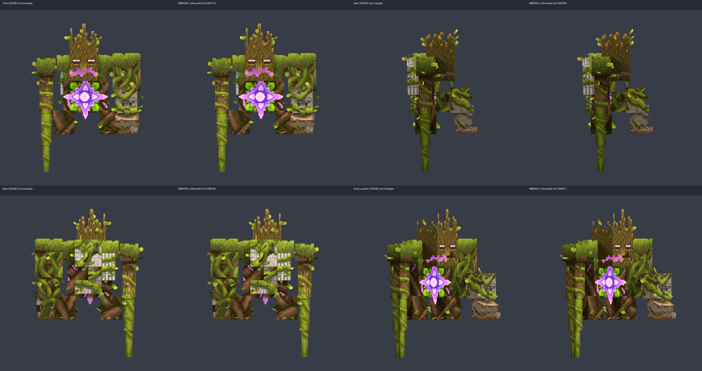

# Static A source / bbmodel comparison

Source-only bounds, unchanged origin/scale; same camera and world lights reused per pair. No independent reframing.

Visible alpha mask: rendered coverage alpha >= 128/255 after source texture alpha > cutoff. Object mask: same geometry made opaque. No dilation, alignment, cropping or rescaling.

Controlled base-texture preview only. No game-renderer, animation, emissive or skin validation.

| View | Visible-alpha IoU | Opaque-geometry IoU | BB reaches image edge |
|---|---:|---:|---|
| front | 0.999719 | 0.933614 | False |
| side | 0.999360 | 0.995378 | False |
| back | 0.999706 | 0.933635 | False |
| three_quarter | 0.999611 | 0.970750 | False |

Overlay: white=intersection, red=source only, blue=bbmodel only.

