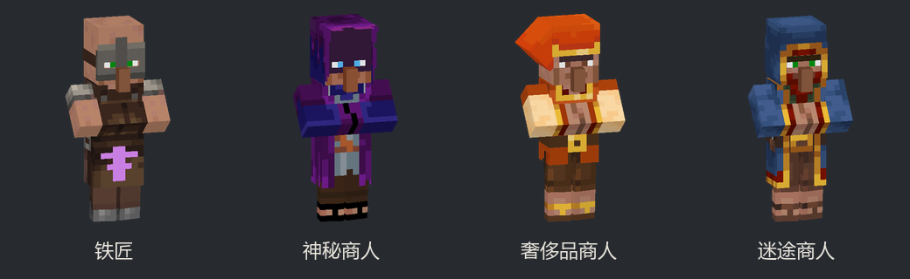
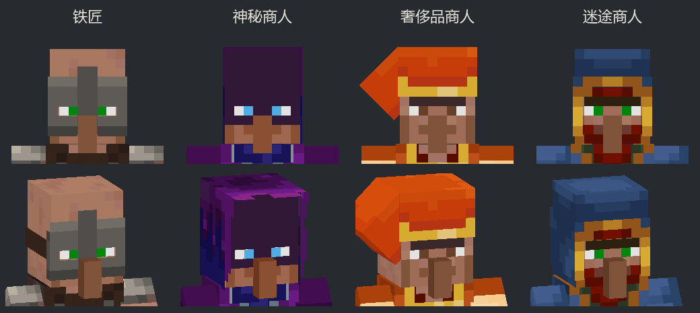

# 四位地下城商人模型

铁匠、神秘商人、奢侈品商人与迷途商人共用原版 `SK_Villager` 的 36 骨骨架，分别使用自己的职业材质和四段原作动作。每位商人在游戏中占 **18 个实体**，包括一只用于交互的村民和 17 个随身的 `item_display`。下图是交付模型的待机首帧渲染。



上排是正面，下排是向侧面偏 18° 的同一帧。铁匠与迷途商人为绿眼，神秘商人为蓝眼，奢侈品商人为棕眼，均取自各自的地下城职业贴图。



## 模型与原版资产

原网格的包路径为 `Dungeons/Content/Actors/Characters/Friendlies/Villager/SK_Villager`。下表列出的材质与贴图都在同一目录，道具位于其 `Merchants/` 子目录。四个参考目录里各有可独立打开的 Blockbench 模型、原版 PNG 副本、材质与部件配置，以及源资产路径和校验信息。

| 商人 / 模型 | 材质 / 原版 64×64 贴图 | 道具与挂点 | 原骨 / 附件骨 | 显示实体 + 载体 |
| --- | --- | --- | --- | --- |
| [铁匠 · merchant_smith](../merchant_smith_dungeons_ref/merchant_smith.bbmodel) | `MI_Villager_Blacksmith` / `T_Villager_Blacksmith` | 护目和围裙来自职业贴图，无独立头部道具 | 36 / 0 | 17 + 1 |
| [神秘商人 · merchant_mystery](../merchant_mystery_dungeons_ref/merchant_mystery.bbmodel) | `MI_Villager_MysteryMerchant` / `T_Villager_MysteryMerchant` | `SM_MysteriousMerchantCap` → `J_Head` | 36 / 1 | 17 + 1 |
| [奢侈品商人 · merchant_luxury](../merchant_luxury_dungeons_ref/merchant_luxury.bbmodel) | `MI_Villager_LuxuryMerchant` / `T_Villager_LuxuryMerchant` | `LuxuaryMerchantHat` → `J_Head` | 36 / 1 | 17 + 1 |
| [迷途商人 · merchant_travel](../merchant_travel_dungeons_ref/merchant_travel.bbmodel) | `MI_Villager_TravellingMerchant` / `T_Villager_TravellingMerchant` | 蓝色头饰使用共享网格自带的 `HatArmorLayer`、`HatArmorSide` 与职业贴图 | 36 / 0 | 17 + 1 |

- **两顶独立帽子**按 `BP_LobbyVillagerMysteryMerchant` 与 `BP_LobbyVillagerLuxuryMerchant` 的组件装配。两者都挂在 `J_Head`，UE 局部位移为 `(0, 180, 0)` 厘米、旋转为零、缩放为一，沿用各自职业材质。奢侈品商人的蓝图直接引用静态网格 `LuxuaryMerchantHat`。帽面随头部一起渲染，四段动作中均保持相同的局部挂点。
- **迷途商人**另查了本机版本全部 45,035 个 `Dungeons/Content/*.uasset` 包头及 34 个村民、商人相关蓝图。对旅行商人材质的引用中没有找到专属头部附件，所以沿用原网格和贴图显示的帽层。
- **贴图**按 [ART-STYLE.md 第 4 节](../../ART-STYLE.md) 保留原网格。参考目录的四份原版 PNG 与解包件逐字节相同。铁匠、奢侈品商人、迷途商人的游戏图集为 64×64。神秘商人的帽子有一个斜向 UV 面，转换器从原像素采样成切片，和完整的原始 64×64 区块一起装入 128×128 图集。四份游戏图集所有可见像素均能在各自原贴图中找到。
- **身高与朝向**按同一比例把身体缩放到 2 格，帽子随头部自然增高。1.21.11 成年村民的乘客位置在脚底上方 1.95 格，模型按该高度回移。转换出的村民鼻尖朝 −Z，模型根部用一个静态朝向组统一到友方 +Z 制作坐标，再应用简报指定的 `turn=180`。已按鼻尖相对头部的位置验证载体 yaw 为 0 时面朝世界 +Z。静态朝向组不占显示实体。

## 四段动作

两列时长分别是地下城原文件记录的秒数，以及 Java 版以 20 刻/秒播放时的片段长度。待机按两刻采样并补间，其余三段逐刻烘焙。每位村民独立记时。

| 入口后缀 | 原动作 | 源帧数 | 源时长 | 游戏时长 | 播放行为 |
| --- | --- | ---: | ---: | ---: | --- |
| `anim/idle` | `Villager_Idle` | 149 | 4.9583335 秒 | 100 刻 | 循环待机 |
| `anim/look` | `Villager_Idle_LookAround` | 70 | 2.3 秒 | 46 刻 | 环顾一次后回到待机 |
| `anim/bow` | `Villager_Bowing` | 50 | 1.6333333 秒 | 33 刻 | 鞠躬一次，配原版 `minecraft:entity.villager.trade` |
| `anim/examine` | `Villager_Examining` | 268 | 8.9 秒 | 178 刻 | 查看物品一次，配原版 `minecraft:entity.villager.ambient` |

## 生成与调用

在仓库的 `_tools` 目录运行以下命令。生成器直接读取随项目交付的四套参考模型，重新生成游戏资源时无需挂载地下城游戏包。

```sh
python add_merchant_models.py ../resourcepack ../rpg
```

在同一目录运行 `python -B merchant_models_ref/render_previews.py` 可重绘四张单人预览、合照和双眼近景。渲染器逐像素比较脸、眼白和瞳孔的深度，透明的面罩像素会露出后方的眼睛。此前按整块面的平均深度排序，导致斜视图中一只眼被脸部盖住。

以目标村民为执行者调用 `rpg:merchant_<职业>/dress`。函数设置 `rpg.mer`、`rpg.mer.<职业>` 标签，将村民设为 NoAI、无敌、持续隐身，并挂载显示部件。对同一村民再次换装会重建其显示部件，保留已有交易数据和其他乘客。已带职业标签的村民也会在 tick 中自动补上整套外观。示例为让最近的铁匠鞠躬：

```mcfunction
execute as @e[type=minecraft:villager,tag=rpg.mer.smith,sort=nearest,limit=1] at @s run function rpg:merchant_smith/anim/bow
```

[外观生成器](../add_merchant_models.py) 只负责模型、音效和动作入口。交易与事件可以在各自的调用位置选择 `bow`、`examine` 或 `look`。

## 验证

- 在独立输出目录与项目包分别运行生成器，四职业共 2,380 个专属资源和函数文件逐字节一致。数据包的 tick、load 标签各有四个唯一入口，保留了运行前已有的条目与顺序。
- 在本机隔离的 **Minecraft Java 1.21.11 原版服务端**载入商人数据包，同时放置四个职业和第二个同点铁匠。核对了每位的实际乘客数、交易保留、重复换装、同点商人各播各的动作、传送转向后跟随、隐身效果恢复，以及移除一位商人后的孤儿部件清理。
- 从四个职业的四段动作中抽取 320 条实时部件变换，16 个职业与动作组合均有实际姿势变化。三个单次动作均验证能回到待机。上方预览取自交付模型的软件渲染；本次服务端验证未包含玩家客户端中的交易界面和画面。
- 单独读取最终资源包中的部件模型、职业图集和数据包中的动作变换，在软件中按 `item_display` 的朝向、背面剔除和深度规则验证。待机正面、左偏 18° 和右偏 18° 共 12 个视图都能分别检出左右眼白和瞳孔。另抽查了环顾、鞠躬、查看物品各一帧；神秘商人环顾时跟随转头方向观察，两只眼都能从兜帽下看到。

