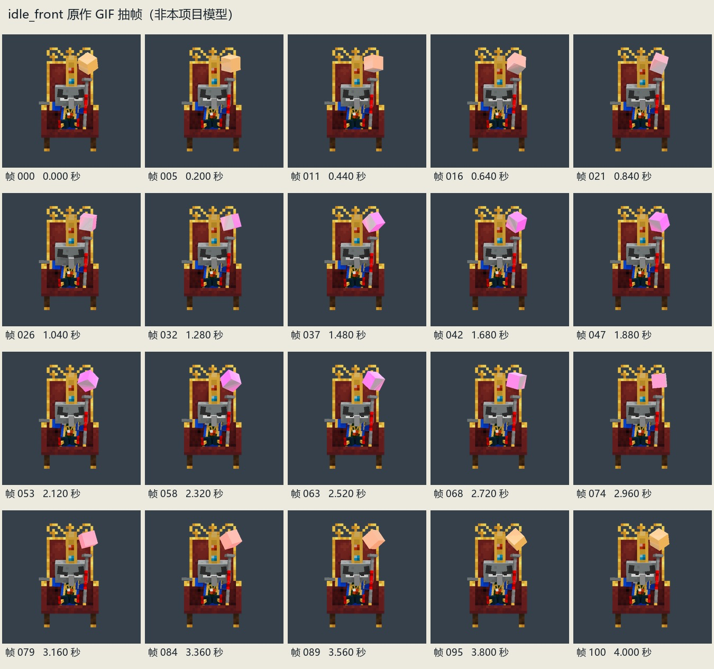
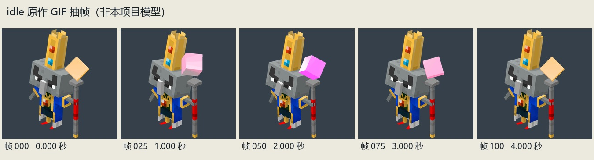
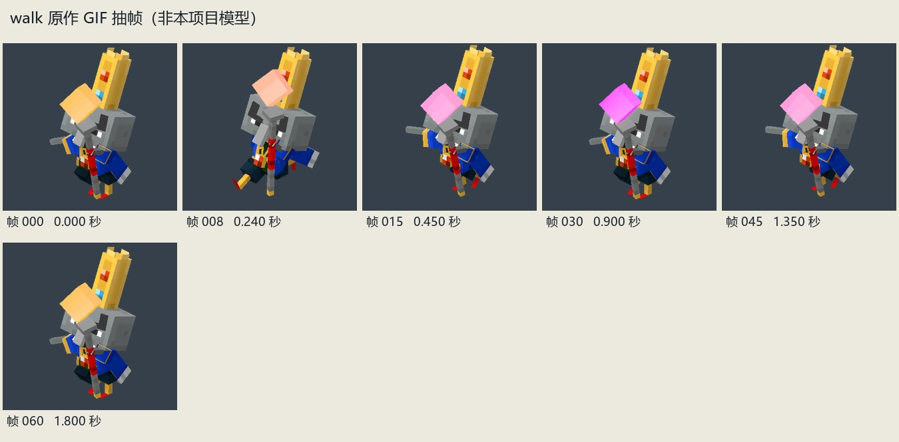
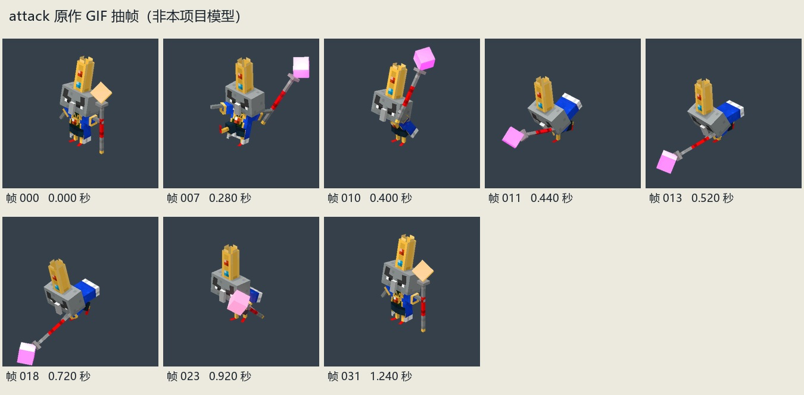
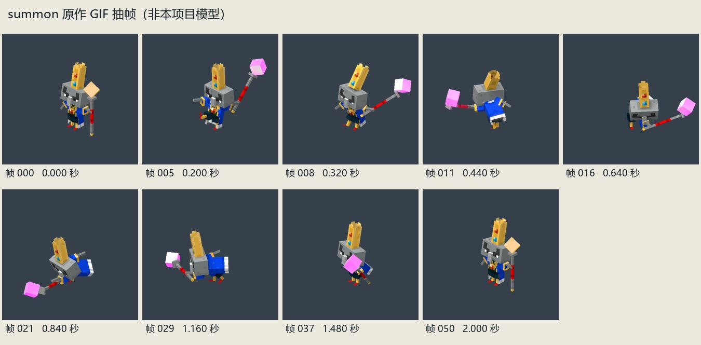
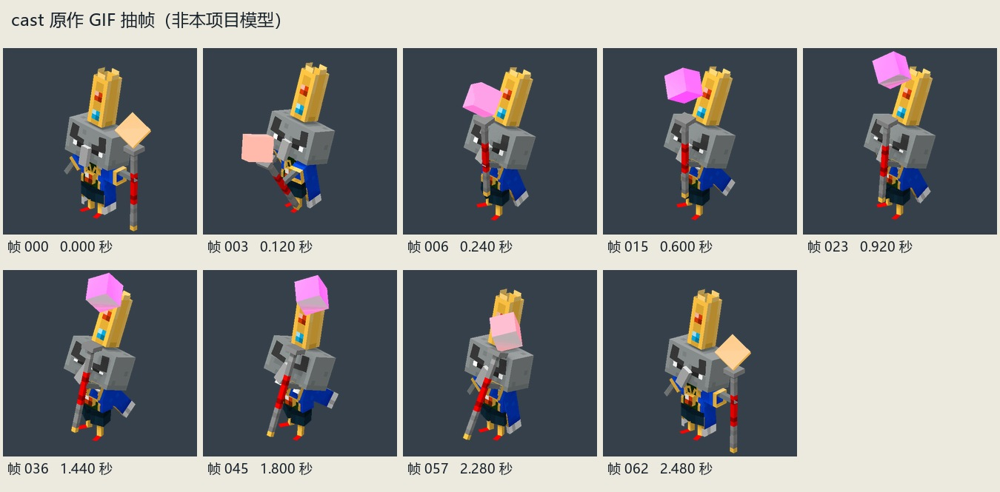
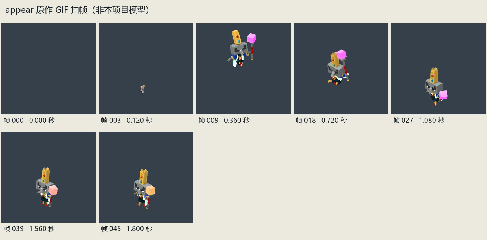
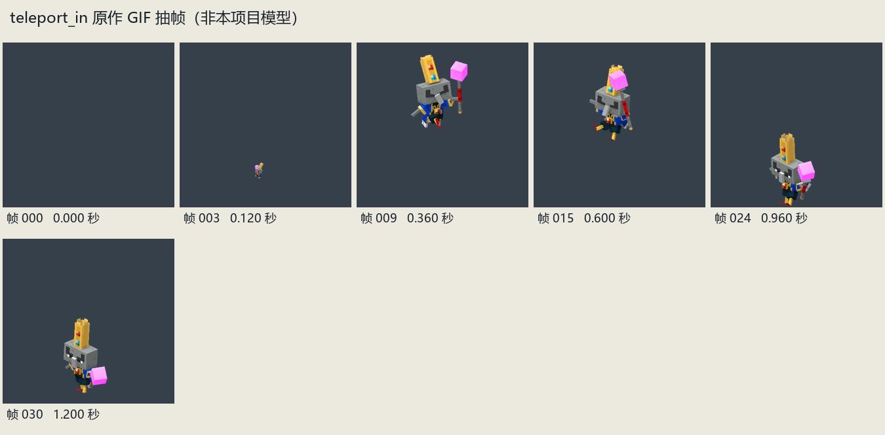
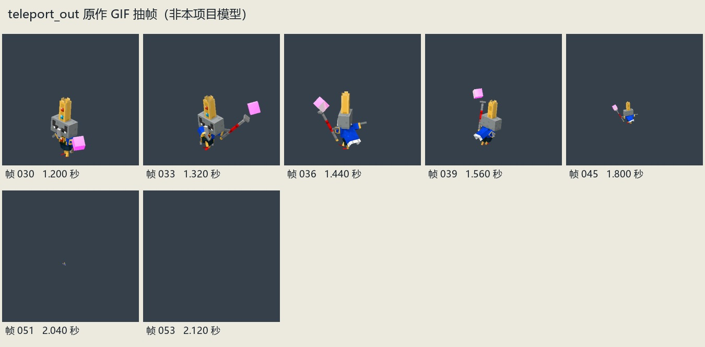
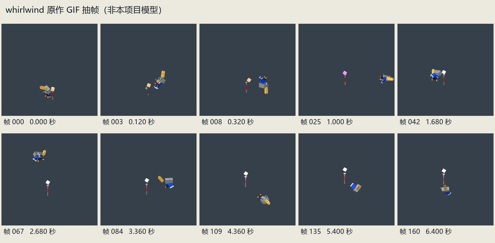

# 教皇 M1：动作来源、时间与关键姿态

本报告只做原始素材分析，没有制作 `pope.bbmodel`、最终关键帧、mcfunction 或 sockets。所有图均为原作 GIF 的解码帧，不是本项目模型渲染，不能用于声称还原度已通过。建议时长与候选出手点尚未获得阶段批准，M3 应在静态模型获批后用最终骨架重做同一时刻并排对照。

## 证据与时间定义

- 来源：[Arch-Illager 图库](https://minecraft.wiki/w/Dungeons:Arch-Illager/Gallery)、[行为说明](https://minecraft.wiki/w/Dungeons:Arch-Illager)。文件实际来源、校验值见上级 `SOURCES.md`、`source_manifest.json`。
- `source_time_seconds` 从 GIF 第 0 帧起，逐帧累加真实 `duration`。GIF 编码长度不等于动画动作长度；尾帧停留、重复帧、透明尾段都单独说明。
- `proposed_clip_time_seconds` 是待批准的本项目 clip 时间，按 0.05 秒烘焙格点给出候选；不是已经写进动画的值。
- 原始帧号从 0 开始。PNG 保持原画布、颜色和透明度；联系表只为展示增加灰色衬底、标签和缩略。`*_detail.jpg` 对所有帧使用同一透明包围盒裁切，位移关系仍保留。
- GIF 没有游戏事件轨道，attack / summon / cast 的“出手”仅指可见姿态候选。没有从画面凭空制造三连发事件，也没有借行为页的延时参数冒充动画关键帧。
- 各 GIF 自带旋转/变色的杖顶。旋转可由独立发光骨骼实现；变色没有现成材质动画证据，本阶段不承诺实现。

## 素材编码校验

共 10 个 GIF，1154 帧；全部帧已解码为 PNG，并记录在 `gif_timing.json`。除 Run 每帧 30ms 外，本组其余文件每帧均为 40ms。

| 来源代号 | 原文件 | 分辨率 | 帧数 | 编码时长（秒） | 首末像素相同 |
|---|---|---|---:|---:|---|
| idle | `MCD_Arch-Illager_Idle.gif` | 666×999 | 101 | 4.04 | 否 |
| idle_front | `MCD_Arch-Illager_Idle_Highblock_Halls_(front_view).gif` | 500×500 | 101 | 4.04 | 是 |
| walk | `MCD_Arch-Illager_Run.gif` | 500×500 | 61 | 1.83 | 是 |
| attack | `MCD_Arch-Illager_Basic_Attack.gif` | 500×500 | 32 | 1.28 | 是 |
| summon | `MCD_Arch-Illager_Summon_Circle.gif` | 500×500 | 51 | 2.04 | 是 |
| cast | `MCD_Arch-Illager_Summon_Single.gif` | 500×500 | 63 | 2.52 | 否 |
| appear | `MCD_Arch-Illager_Appear.gif` | 500×500 | 249 | 9.96 | 是 |
| teleport | `MCD_Arch-Illager_Teleport_(Appear_Short).gif` | 500×500 | 135 | 5.40 | 是 |
| whirlwind_game | `MCD_Arch-Illager_Defeated_in_a_Whirlwind_in_game.gif` | 800×800 | 161 | 6.44 | 否 |
| whirlwind_full | `MCD_Arch-Illager_Defeated_in_a_Whirlwind.gif` | 800×800 | 200 | 8.00 | 否 |

## 持杖手与结构证据

**权杖由角色左手持有。** `idle_front` 正面帧 0 / 25 / 50 / 75 / 100，权杖始终位于画面右侧；普通 idle 与 attack 的连续运动一致。骨骼必须按角色身体左右命名，不能把画面右侧误写成 `right_hand`。本项目 Java 坐标约定中，角色左侧为 -X。



whirlwind_game 第 84 帧（3.36 秒）能直接看见皇冠与头部之间的空隙；权杖早在第 3 帧（0.12 秒）已和持握手分离。皇冠、权杖必须能独立于头/左手运动。

[查看 3.36 秒原始掉冠帧](frames/whirlwind_game/0084.png)

## 9 段接口与时长建议（未锁定）

| ID | clip | 循环 | 证据 | GIF 编码长度（秒） | 建议 clip（秒） | 候选出手（clip 秒） |
|---:|---|---|---|---:|---:|---|
| 0 | `idle` | 是 | 有动图 | 4.04 | 4.00 | —（候选） |
| 1 | `walk` | 是 | 有动图 | 1.83 | 1.80 | —（候选） |
| 2 | `attack` | 否 | 有动图；出手候选为推断 | 1.28 | 1.25 | 0.50（候选） |
| 3 | `summon` | 否 | 有动图；出手候选为推断 | 2.04 | 2.00 | 0.65（候选） |
| 4 | `cast` | 否 | 有动图；出手候选为推断 | 2.52 | 2.50 | 0.90（候选） |
| 5 | `appear` | 否 | 有动图；片段剪裁与无缩放适配为推断 | 9.96 | 1.80 | —（候选） |
| 6 | `teleport_in` | 否 | 有共用动图；切段与时长适配为推断 | 5.40 | 0.90 | —（候选） |
| 7 | `teleport_out` | 否 | 有共用动图；切段与时长适配为推断 | 5.40 | 0.90 | —（候选） |
| 8 | `whirlwind` | 否 | 有动图；最后中心收拢为推断 | 6.44 | 7.00 | —（候选） |

## 关键姿态表

### 0 / idle

**证据：有动图。** 末帧在4.00s，GIF另含40ms尾帧；身体微动与杖顶立方旋转可见。材质粉/白/橙色周期不是rotation/position通道，固定原贴图，不冒充已经实现动态发光。

源片段：0.00–4.00 秒；建议 clip 长度：4.00 秒。

| 原 GIF 帧 | 原 GIF 秒 | 建议 clip 秒 | 观察到的姿态 / 推断 |
|---:|---:|---:|---|
| 0 | 0.00 | 0.00 | 直立，左手持杖近竖直，右臂自然向外下垂 |
| 25 | 1.00 | 1.00 | 姿态仅小幅起伏；观察头、肩与杖握点紧凑关系 |
| 50 | 2.00 | 2.00 | 杖顶立方已旋转，身体维持直立 |
| 75 | 3.00 | 3.00 | 继续小幅静息；杖头旋转相位变化 |
| 100 | 4.00 | 4.00 | 接近首姿，闭环前须检查所有骨骼插值接缝 |



### 1 / walk

**证据：有动图。** 源名 Run；本项目接口固定叫walk。首末像素完全相同；去掉重复尾帧后周期1.80s。腿交替抬起，持杖手维持胸前，右臂摆动。

源片段：0.00–1.80 秒；建议 clip 长度：1.80 秒。

| 原 GIF 帧 | 原 GIF 秒 | 建议 clip 秒 | 观察到的姿态 / 推断 |
|---:|---:|---:|---|
| 0 | 0.00 | 0.00 | 权杖在胸前偏左侧，腿开始交替 |
| 8 | 0.24 | 0.25 | 一腿前踢、另腿后撤，躯干轻斜 |
| 15 | 0.45 | 0.45 | 换步，空手向外摆 |
| 30 | 0.90 | 0.90 | 中段跑步相位，须依据脚端而非杖头色彩判断周期 |
| 45 | 1.35 | 1.35 | 后半段交替步态 |
| 60 | 1.80 | 1.80 | 回到首帧姿态 |



### 2 / attack

**证据：有动图；出手候选为推断。** 只见一次准备→前压伸杖→回收，不能据此编造三次挥杖；三连弹由玩法接口处理。建议时长1.25s是20TPS量化，源末姿1.24s。

源片段：0.00–1.24 秒；建议 clip 长度：1.25 秒。

| 原 GIF 帧 | 原 GIF 秒 | 建议 clip 秒 | 观察到的姿态 / 推断 |
|---:|---:|---:|---|
| 0 | 0.00 | 0.00 | 起手直立 |
| 7 | 0.28 | 0.30 | 左臂举杖向后上，右臂伸出，双脚抬起 |
| 10 | 0.40 | 0.40 | 身体开始强烈前倾，权杖仍近头侧 |
| 11 | 0.44 | 0.45 | 快速转入前压，权杖横向指前 |
| 13 | 0.52 | 0.50 | 躯干前压、杖尖伸至前方，出手候选 |
| 18 | 0.72 | 0.70 | 维持前伸姿态 |
| 23 | 0.92 | 0.90 | 收杖起身 |
| 31 | 1.24 | 1.25 | 恢复首姿 |

出手候选：原 GIF 0.52 秒 → clip 0.50 秒。**前压伸杖已到位的姿态候选，未见能量弹，不能当作原作精确发射事件。**



### 3 / summon

**证据：有动图；出手候选为推断。** 包含完整转身横扫和前压，不能只用两臂抬起代替。

源片段：0.00–2.00 秒；建议 clip 长度：2.00 秒。

| 原 GIF 帧 | 原 GIF 秒 | 建议 clip 秒 | 观察到的姿态 / 推断 |
|---:|---:|---:|---|
| 0 | 0.00 | 0.00 | 起手直立 |
| 5 | 0.20 | 0.20 | 左臂将杖举向后上，抬腿 |
| 8 | 0.32 | 0.30 | 杖尖开始落入横扫，身体偏转 |
| 11 | 0.44 | 0.45 | 转身露出背部，杖横置一侧 |
| 16 | 0.64 | 0.65 | 再转至正面，权杖横过身前；出手候选 |
| 21 | 0.84 | 0.85 | 前压伸杖，蓝袍背面翘起 |
| 29 | 1.16 | 1.15 | 保持前压并继续转动 |
| 37 | 1.48 | 1.50 | 回收权杖、起身 |
| 50 | 2.00 | 2.00 | 回到首姿 |

出手候选：原 GIF 0.64 秒 → clip 0.65 秒。**转身横扫中权杖横过身前，作为环召唤候选；GIF未显示召唤实体。**



### 4 / cast

**证据：有动图；出手候选为推断。** 参考Summon_Single，只见抬杖与高举保持，源图没有红石傀儡出生事件。加护/圣血祭/收回契约共用此动作是项目适配。

源片段：0.00–2.48 秒；建议 clip 长度：2.50 秒。

| 原 GIF 帧 | 原 GIF 秒 | 建议 clip 秒 | 观察到的姿态 / 推断 |
|---:|---:|---:|---|
| 0 | 0.00 | 0.00 | 直立起手 |
| 3 | 0.12 | 0.10 | 杖从身侧带到脸前，杖杆倾斜 |
| 6 | 0.24 | 0.25 | 杖竖起，杖头到达头冠侧上方 |
| 15 | 0.60 | 0.60 | 身体微后仰，杖继续高举 |
| 23 | 0.92 | 0.90 | 高举稳定段，出手候选 |
| 36 | 1.44 | 1.45 | 仍举杖，头与冠一起后仰 |
| 45 | 1.80 | 1.80 | 开始放下，杖头绕回额前 |
| 57 | 2.28 | 2.30 | 杖回到胸前，准备落至身侧 |
| 62 | 2.48 | 2.50 | 恢复站姿 |

出手候选：原 GIF 0.92 秒 → clip 0.90 秒。**高举权杖的稳定段候选；不是由GIF证明的原作召唤/加护事件。**



### 5 / appear

**证据：有动图；片段剪裁与无缩放适配为推断。** 建议只取前1.8s到落定，须用户阶段确认。原GIF后段还有举杖、前压、离场；166帧=6.64s为最后非透明帧，167..248全空，不能整段9.96s当登场。源角色视觉大小明显变化，当前rotation/position管线不能声称原样实现缩放/隐现。

源片段：0.00–1.80 秒；建议 clip 长度：1.80 秒。

| 原 GIF 帧 | 原 GIF 秒 | 建议 clip 秒 | 观察到的姿态 / 推断 |
|---:|---:|---:|---|
| 0 | 0.00 | 0.00 | 画面透明，人物未可见 |
| 3 | 0.12 | 0.10 | 人物在低处很小，侧背朝镜头 |
| 9 | 0.36 | 0.35 | 转向前方并上升到高处，左手举杖 |
| 18 | 0.72 | 0.70 | 向落地点下降，腿悬空 |
| 27 | 1.08 | 1.10 | 落至低位、杖降至身前 |
| 39 | 1.56 | 1.55 | 起身并将杖还原身侧 |
| 45 | 1.80 | 1.80 | 到达可衔接站立的姿态，建议剪裁终点 |



### 6 / teleport_in

**证据：有共用动图；切段与时长适配为推断。** 页面确认in/out各0.9s。按GIF出现段0..1.20s压到0.9s，映射t_clip=0.75*t_source，最终帧落到20TPS。不是使用整段5.4s。

源片段：0.00–1.20 秒；建议 clip 长度：0.90 秒。

| 原 GIF 帧 | 原 GIF 秒 | 建议 clip 秒 | 观察到的姿态 / 推断 |
|---:|---:|---:|---|
| 0 | 0.00 | 0.00 | 透明起点；缩放/隐藏不可直接由现有通道实现 |
| 3 | 0.12 | 0.10 | 小体积出现，侧向旋转 |
| 9 | 0.36 | 0.25 | 举杖升起，面向前方 |
| 15 | 0.60 | 0.45 | 下降，膝与手臂保持悬空姿态 |
| 24 | 0.96 | 0.70 | 下降到低位，杖移到身前 |
| 30 | 1.20 | 0.90 | 出现段末端、离场段前的低位站姿 |



### 7 / teleport_out

**证据：有共用动图；切段与时长适配为推断。** 共用GIF本身显示离场段，无需无依据倒放出现段。图库截图说明为appear的缩短动画，行为页确认0.9s；1.20..2.12s映射到0..0.9s。帧52=2.08s仍有像素，53起全空。

源片段：1.20–2.12 秒；建议 clip 长度：0.90 秒。

| 原 GIF 帧 | 原 GIF 秒 | 建议 clip 秒 | 观察到的姿态 / 推断 |
|---:|---:|---:|---|
| 30 | 1.20 | 0.00 | 起始站姿，杖在身前 |
| 33 | 1.32 | 0.10 | 抬杖并转身 |
| 36 | 1.44 | 0.25 | 背面朝镜头，权杖外展 |
| 39 | 1.56 | 0.35 | 继续旋转，双脚收起 |
| 45 | 1.80 | 0.60 | 人物视觉大小快速缩小 |
| 51 | 2.04 | 0.80 | 仅剩极小可见形体 |
| 53 | 2.12 | 0.90 | 完全透明；当前通道不能直接实现隐藏 |



### 8 / whirlwind

**证据：有动图；最后中心收拢为推断。** 建议保持原game节奏至6.4s，再以0.6s补作全部刚性部件中心收拢；这段无原作精确姿态证据，须确认。full8.0s辅助看翻滚，末尾人物也仍可见。没有scale，重叠不等于零体积；整根权杖不会消失。

源片段：0.00–6.40 秒；建议 clip 长度：7.00 秒。

| 原 GIF 帧 | 原 GIF 秒 | 建议 clip 秒 | 观察到的姿态 / 推断 |
|---:|---:|---:|---|
| 0 | 0.00 | 0.00 | 身体已弯腰，杖开始脱离握持 |
| 3 | 0.12 | 0.10 | 人物与权杖明显分离，杖近竖直留在中心 |
| 8 | 0.32 | 0.30 | 人物翻至倒置，四肢张开 |
| 25 | 1.00 | 1.00 | 绕杖远离中心并翻滚，保留整体转动 |
| 42 | 1.68 | 1.70 | 人物绕回杖边，躯干横置 |
| 67 | 2.68 | 2.70 | 继续上方翻滚，杖保持独立 |
| 84 | 3.36 | 3.35 | 皇冠明显脱离头顶，必须独立运动 |
| 109 | 4.36 | 4.35 | 人物在杖下方翻滚，逐渐向中心靠近 |
| 135 | 5.40 | 5.40 | 身体在中心下侧旋转，四肢仍伸展 |
| 160 | 6.40 | 6.40 | 人物位于权杖下方，仍完整可见；不是吸入完成 |
| — | — | 7.00 | 推断补作：所有部件中心收拢到交接中心；刚性体积仍存在 |



## 必须在后续阶段明确的差异

1. **登场剪裁。** Appear 的 9.96 秒文件并非只包含入场：可见内容结束于帧166（6.64秒），167–248全透明；中间还有举杖、前压和离场。建议只取0–1.80秒落定，不能直接把整个文件当登场 clip。
2. **瞬移来源与时长。** Teleport GIF 本身包含进入和离开，不必无证据地倒放进入。建议入场源0–1.20秒压到0.90秒，离场源1.20–2.12秒压到0.90秒。帧52（2.08秒）仍有少量像素，53–134全透明。图库说明“appear缩短版”和行为页“in/out各0.9秒”只支持动作来源与目标时长，不提供精确切点，以上切点属于适配推断。
3. **瞬移的视觉大小与隐藏。** 源图出现由小到大、离场由大到小的变化。仅从截图不能证明这是原作scale轨道、深度运动或渲染机制造成；现有模型通道仅rotation/position，不能声称实现了同样的缩放或完全透明。不得暗中加入scale/Molang、半透明效果。
4. **whirlwind结尾。** game末帧6.40秒和full末帧7.96秒的人物都仍可见，未观测到所有部件缩成一个点。建议game段之后0.60秒收拢是为项目交接补作，必须标“推断”。刚性部件中心重叠不会使体积消失，尤其整根权杖仍有长度；末帧交接/移除的实现边界需和玩法方约定，本任务不写玩法。
5. **首尾过渡。** 非循环动作当前共享管线会回idle。teleport_out / whirlwind不能仅靠最后一帧当作永久隐藏或姿态保持，M4需验证约定的结束交接，不能用“构建通过”替代验证。
6. **未验证项。** 未制作实际模型、未做模型与原作并排、未在Blockbench摆动画、未测sockets、未在真实游戏内看过。M1图只支持关键姿态和来源分析。

## 可复现命令

```powershell
python _tools/pope_motion_study.py
```

`clips.json` 是本阶段人工观察记录；脚本读取它生成关键姿态联系表和本报告。所有真实动画以后以 `pope.bbmodel` 为事实来源，本JSON不得冒充最终动画数据。
