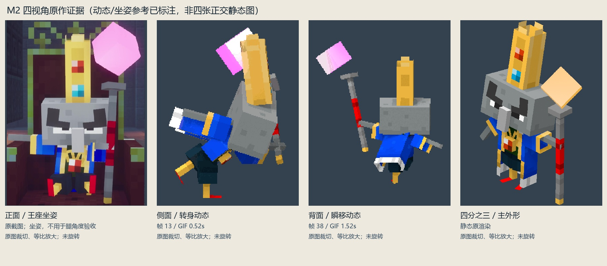
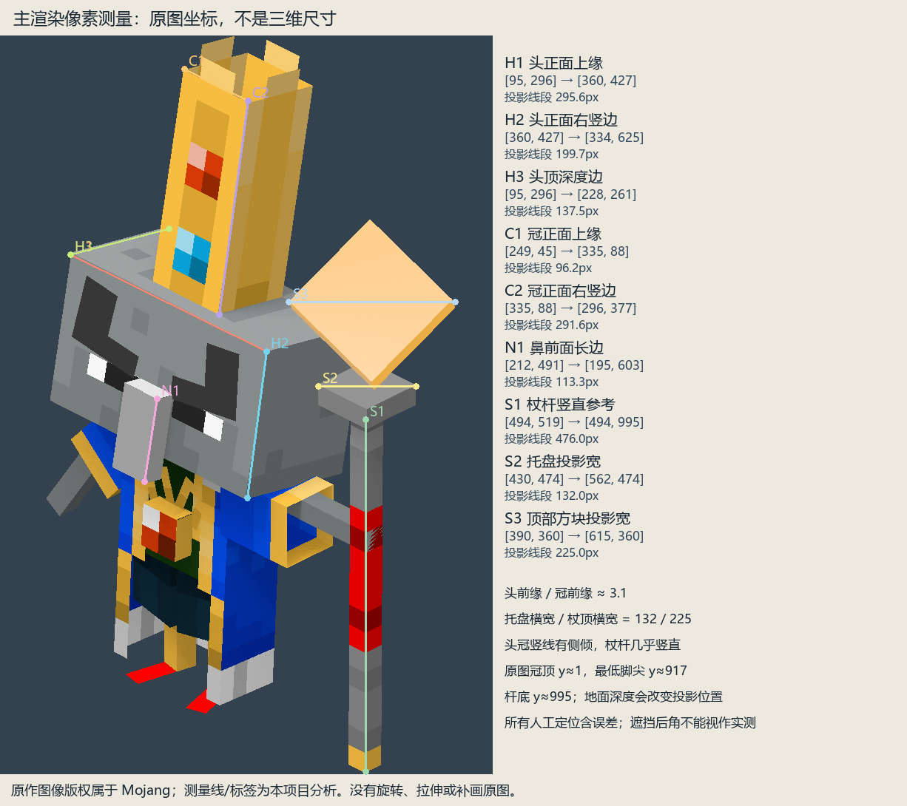

# 教皇 M2：静态参考取景与比例证据

本目录只整理原作证据，没有修改或生成模型、动画，也没有操作 Blockbench。

## 视角限制

正面采用1920×992王座原截图，冠、脸、项链与左手握杖较清楚，但它是坐姿、轻俯视透视；不能把膝脚角度当站姿要求。正面GIF第0帧作为辅助。

侧面取 Summon_Circle 第13帧（0.52秒）；背面取 Teleport 第38帧（1.52秒）。二者都是转身时刻，衣摆被扬起且腿屈曲。它们支持侧背材质和部件朝向检查，不是正交静态三视图。没有旋转图片来冒充其他视角。所有裁片仅裁切、等比显示，原坐标与裁框写入 `reference_views.json`。

四分之三使用主渲染 MCD_Arch-Illager.png；建议原生Blockbench相机先试 yaw约42°（±7°）、向下俯视约23°（±7°），再匹配头盒可见边。此角度来自投影估计，不是官方参数。主图头/皇冠竖边在画面中侧倾约8°，杖杆基本竖直，不能为贴合头冠而把整个模型或相机连权杖一起斜。

## 比例与布局起点

主图头前缘与冠前缘投影长度约297:96≈3.1，支持头宽12、冠宽4的起点。头12×7×6、冠4×11×4、鼻2×4×2来自贴图盒网候选加图像交叉核对，仍不是官方geometry。身体可先按约9宽、9高、5深布局，细灰臂约1截面、8长；这些弱证据项必须看模型并排后再定。

按脚段约2、躯干约9、头7、冠11估计人物高约29模型单位，暂用 `model_scale = 2.6 * 16 / 29 ≈ 1.434483`。最终必须从bbmodel最高冠齿到最低脚端重新量包围盒，不能照抄这个试模值。

杖杆1×18×1、托盘3×1×3与原权杖UV较一致；主图顶部块的投影宽约225px，托盘约132px，比约1.70。单杖图顶块/托盘投影宽约342/171=2.0，差异来自方块自身朝向与视角。顶块可先试边长5，再同时核对两个渲染；投影包围盒比值不能直接当三维边长比。

## 骨架与衣摆

- 角色左手持杖（Java -X）；图中右侧不是角色右手。
- 头、肩、项链相接很紧，不能做长脖颈或把肩远离头下沿。主图持杖灰臂从约(390,625)直接连向约(494,682)握点；这些是图像地标，不是骨骼pivot。
- Summon_Circle帧11–13和Teleport帧36–38连续显示：白色下缘随蓝色后布一起摆动；细金腿与红脚尖独立露在下方。因此不要把主图所有灰白下端直接当白靴，先把白边和袍/背布一起核验。这是连续帧支持的结构推断，不声称已取得原拓扑。
- 背面冠壁无正面的红蓝宝石列，背头无眼眉。背布朝身体后方，白下缘向下；侧背图必须一同检查，避免正反装错。
- 杖底在主图比脚尖投影低约80px；深度投影会改变同一地平面的画面高度，不能由这点直接把模型杖杆埋入地面。

## 机器可读产物

`reference_views.json` 包含原文件哈希、帧号、源时间、原画布、alpha边界、取景框、相机候选与误差、姿态/遮挡说明、像素线段、比例和尺寸建议。图中坐标全部以未裁切原图为准。`front_landmarks.png` 标出正面头冠/鼻/吊坠等地标，但它们不是骨骼锚点。

运行：`python _tools/pope_m2_reference.py`。只写本目录；原作图像版权归 Mojang，本项目非商业，与 Mojang 无关联。
