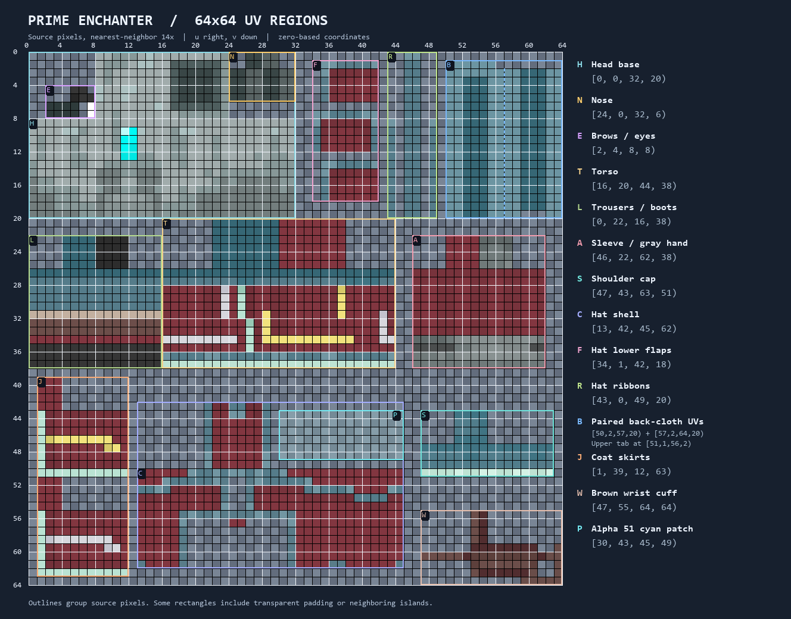
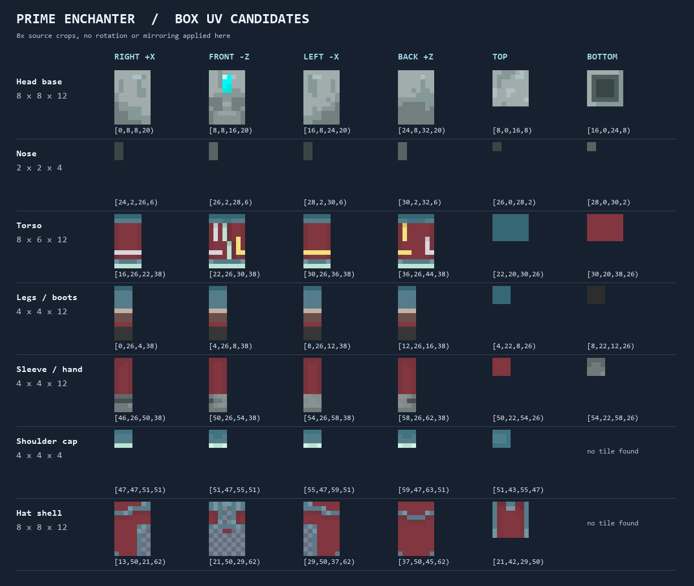
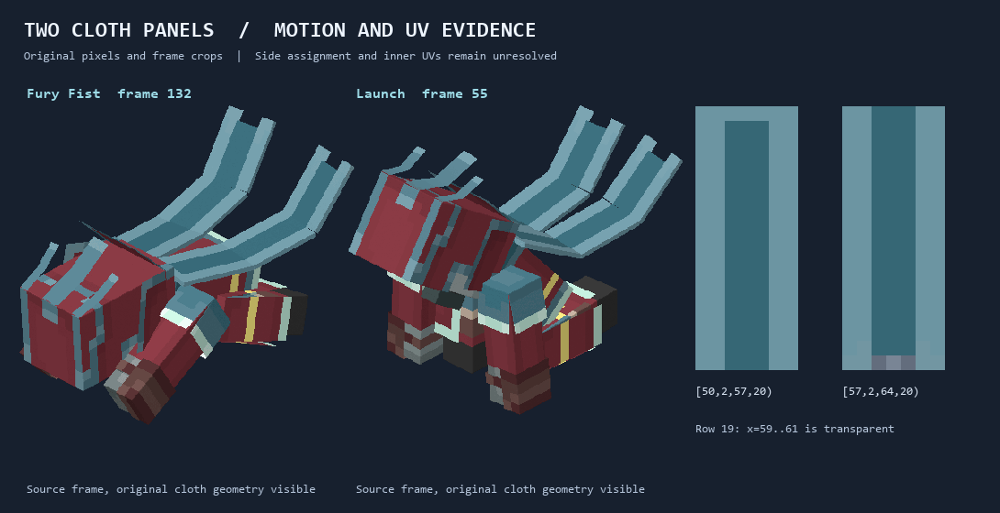

# 首席附魔师的 UV 与部件研究

本页以 Wiki 64×64 的 `MCD2_Prime_Enchanter_(texture).png` 为像素依据。Wiki 的 `MCD2_Prime_Enchanter_Render.png` 和 11 段 GIF 给出立体轮廓、出拳与布片运动。实机登场的 f00618、f00870、f00900 补充眼鼻正面、元素拳套和背部细节。Mojang 的 `bft-pe.jpg` 提供官方拳套海报对照。以下矩形来自 PNG 原像素。精确几何、枢轴和局部贴面方向须在 M2 多视角试装。

Wiki PNG 文件 SHA-256 为 `19c0d1bb329bff391558a4a4f7a23c002835c108af39064f7034c2a5acdf25a3`。资料站曾提供另一份编码的 PNG，文件 SHA-256 为 `4625383f9792b14091ce1682f3181adda6d02694fa3a006edf57bd2e0e530c2f`。两份解码后的 4096 个 RGBA 像素逐个相同，按左到右、上到下的 RGBA 字节计算 SHA-256 为 `7596f21616a47b3ef06be12ebb442f5ff2250dde2cf4939fcb90f5fc50f8ef06`。只保留 Wiki 原件。

原图有 2582 个不透明、1424 个完全透明、90 个 alpha=51 像素。90 个半透明像素全部集中在 `[30,43,45,49)`，是均一的 `#BCFCFB` 青片。图中的透明区域按 alpha 判定，完全透明像素中保留的 RGB 颜色没有计入可见面。

## 盒式展开

所有 `[u0,v0,u1,v1)` 均为原图像素边界，右端与下端不含。模型朝 `-Z`，角色右侧为 `+X`。头和躯干的正面由青色圣核和衣襟颜色锁定。躯干 `[16,26,22,38)` 带白横边，与 f00870 的角色右侧相符，`[30,26,36,38)` 带金黄横边，与角色左侧相符。其余盒网按同一顺序列候选，左右面的最终镜像、帽壳背面透明缺口朝向和顶底翻转仍须用 M2 对照确认。`W×D×H` 是 UV 的长宽关系，几何允许使用非整数比例。

| 部件 | W×D×H | 右侧 +X | 正面 -Z | 左侧 -X | 背面 +Z | 顶面 | 底面 | 证据 |
|---|---:|---|---|---|---|---|---|---|
| 头底 | 8×8×12 | `[0,8,8,20)` | `[8,8,16,20)` | `[16,8,24,20)` | `[24,8,32,20)` | `[8,0,16,8)` | `[16,0,24,8)` | 四张 8×12 的灰色侧片连成整带，8×8 顶底连在其上。正面有 2×4 的亮青圣核与下脸色阶。 |
| 鼻 | 2×2×4 | `[24,2,26,6)` | `[26,2,28,6)` | `[28,2,30,6)` | `[30,2,32,6)` | `[26,0,28,2)` | `[28,0,30,2)` | 8×4 的深灰条中，每 2 列在 `#394646` 和 `#586363` 间交替，连两个 2×2 顶底。鼻子朝向可用阴影图进一步校对。 |
| 躯干 | 8×6×12 | `[16,26,22,38)` | `[22,26,30,38)` | `[30,26,36,38)` | `[36,26,44,38)` | `[22,20,30,26)` | `[30,20,38,26)` | 侧带宽 28=6+8+6+8，青领、白黄衣襟、青白底边与渲染吻合。原作正面色块明显不对称。 |
| 裤腿／黑靴 | 4×4×12 | `[0,26,4,38)` | `[4,26,8,38)` | `[8,26,12,38)` | `[12,26,16,38)` | `[4,22,8,26)` | `[8,22,12,26)` | 一条 16×12 的分层色带和一对 4×4 顶底。侧带四片完全同色分布，可供双腿共用。蓝裤上部、棕色下段及黑靴脚掌与站姿相符。 |
| 红袖／灰手 | 4×4×12 | `[46,26,50,38)` | `[50,26,54,38)` | `[54,26,58,38)` | `[58,26,62,38)` | `[50,22,54,26)` | `[54,22,58,26)` | 16×12 侧带上 8 行红、下 4 行灰，两张 4×4 顶底为红、灰各一。关节若分开，四侧在 y=34 分面；袖子遮住的内端不采别处颜色。 |
| 青肩罩 | 4×4×4 | `[47,47,51,51)` | `[51,47,55,51)` | `[55,47,59,51)` | `[59,47,63,51)` | `[51,43,55,47)` | 缺失 | 16×4 侧带四等分，顶部紧邻一张 4×4 青片。最底一行是浅色袖口线。下端位于袖内，保留开口候选。 |
| 酒红帽外罩 | 8×8×12 候选 | `[13,50,21,62)` | `[21,50,29,62)` | `[29,50,37,62)` | `[37,50,45,62)` | `[21,42,29,50)` | 缺失 | 拓扑与 8×8 头盒外层相合。正面上沿的青边和青核开口、下半的露面缺口支持此方向。顶部和侧片有透明边界，须保留。帽底没有一张确认的贴片。 |

`[11,9,13,13)` 是头正面的青核采样位置。它含亮角 `#BCFCFB`、青色 `#00F9F5`、暗青 `#00E7E3`。它与帽罩正面 `[21,50,29,62)` 内的 2×4 透明窗 `[24,51,26,55)` 位置相合。实机 f00618 显示黑眉宽过眼白，鼻梁居中前突，两只白色亮瞳靠内眼角。眼眉的候选区域为 `[2,4,8,8)`，其中 `[7,6,8,8)` 是 1×2 白色片，作为双眼共享裁片后仍须核对朝向。青核和白瞳如需独立全亮平面，M2 须用略微分离的几何检查共面闪烁，同时保留青核原像素亮暗阶。

## 尚待试装的区域

| 原图区域 | 可核对的观察 | M2 候选 |
|---|---|---|
| `[35,1,42,6)`、`[34,7,42,12)`、`[35,13,42,18)` | 三张分离的酒红片带青蓝窄边，中片较宽。实机 f00900 可见背面完整的青边红颈片，Wiki 连拳第 110 帧可见侧翻片的蓝色竖边与红底。 | 中片优先试作后颈护片，其余两片作为左右侧翻片。用 f00900 和连拳第 110 帧检查背片 U 方向、侧片倾角及翻片与主帽交线。 |
| `[43,8,44,20)`、`[45,0,47,20)`、`[48,8,49,20)` | 两根 1×12、一根 2×20 的狭长青片。登场第 6 帧可同时看到帽后三带和独立宽披风。海报里帽带从帽后翻起，中央宽于两边。 | 三根帽后飘带。以登场第 6 帧校根部和带宽，以待机第 0 帧校短垂轮廓。UV 带全长不能直接当作三根带的可见静态长度。 |
| `[50,2,57,20)`、`[57,2,64,20)`，另有首半段上缘 `[51,1,56,2)` | 各 7×18，y=3…17 都是浅×2、深×3、浅×2 的竖带。第二半在末行 x=59…61 透明。连拳第 132 帧和天降第 55 帧清楚分出两块长披布，每片各有两浅边和两个折点。 | 先分别试装两半原像素，比较 y=1 上缘、末端缺口、披片间距及两处折点。两半的左右归属、是否含一片的正反面、内外如何共用仍不能唯一恢复。沿长度切上、中、下三段，每段含两薄片，保留末行透明缺口。用连拳第 110／132 帧、天降第 55 帧和 f00900 验证。 |
| `[1,39,12,51)`、`[1,51,12,63)` | 两张衣摆各有 3×4 上耳与 11×8 带状区，下摆浅青，一张带黄线、一张带白线。f00870 正面和 f00900 背面确认角色左腿黄、右腿白。 | 左右外袍片包住裤腿，保留中间开衩。用站姿、走路第 12 帧、受击第 24 帧检查黄白线绕边。11 像素带不足以唯一解出三面分割、内侧贴面和厚度。 |
| `[47,55,64,64)` | 棕红色折带与小端面。Wiki 渲染、连拳第 110 帧和突进第 39 帧中，常态护拳外侧棕色，指面露灰。 | 棕拳腕外壳。把 `[53,59,60,63)` 多条同色带与旁边的窄段拼作候选，四侧保持棕色横带方向，另以真实灰手指面校正开口。用待机弯腕、突进直拳、登场第 6 帧垂臂三姿核对相接，防止选到透明的护腕内侧。 |
| `[30,43,45,49)` | 15×6 匀色青片，alpha=51。 | 单独存档。用途未证实，不分配给帽底或两只元素拳套。 |

## 拳套与颜色

Mojang `bft-pe.jpg`、实机 f00870 与 f00900 一致确认角色右手（模型 `+X`）为冰蓝、角色左手（模型 `-X`）为黄电。海报中冰拳为青白亮边和蓝色面，电拳为浅金亮边、黄色面与腕部格栅。实机的两只外盒有亮边和能看见棕拳的半透明中心，周围另有冰屑和电光。11 段 Wiki GIF 各取 10 个等距样本核对，包含超载、雷击、连拳和突进，所见皆是灰手与棕色护拳。优先用这些原像素完成基础模型，并保留两手挂点。若后续需要带冰电的视觉附件，按实机外框和半透明中心独立制作，另记新增像素及是否含发光／粒子。基础模型沿用酒红、青蓝及白黄镶边，便于未来单独改出白金版本。

## 部件和运行接口候选

| 计划部件 | 组成及枢轴 | 初始合并判断 |
|---|---|---|
| `body` | 躯干、领、腰带，绕髋上部 | 保持一体。 |
| `head` | 头脸、鼻、眼眉、青核、帽壳、侧翻片、后颈片 | 源帧未见帽与头分离，优先合并为一个显示部件。帽侧片试装的多轴角度若不能静态合并，再调整层级。 |
| `right_arm`、`left_arm` | 红袖和青肩罩绕肩 | 先验证肩罩与袖同轴；兼顾左右拳交替和双拳合落。 |
| `right_hand`、`left_hand` | 灰手及棕腕，绕腕 | 分腕保留连拳和格挡的手势。右冰左电分别提供效果挂点。 |
| `right_leg`、`left_leg` | 裤腿、靴、左右不对称袍摆，绕髋 | 白黄袍摆按图验证对应侧，保留开衩。若原作袍摆需独立运动，再依据预算拆骨。 |
| `cape_upper`、`cape_mid`、`cape_lower` | 两块长披布共用三段纵向枢轴，每段包含左右各一薄片 | 连拳第 110、132 帧和天降第 55 帧支持两处折点。共享枢轴是展示部件预算内的候选，若 M3 发现两片独立转角必须保留，再评估拆分。 |
| `hat_ribbons` | 3 根青带，分别保留原宽度和长度候选 | 先共用一显示部件。若 M3 证明各自有显著独立摆动，依据可见动作重新分配预算。 |

候选为 8 个身体件、3 段披布、1 个帽带部件，共 12 个显示实体。空的 `root` 只组织层级。挂点建议为 `right_ice_fist`、`left_electric_fist`、`head_core`、`ground_impact`，随证据锁定时刻。`ground_impact` 表示相对载体的模型接触点，实际落点由未来战斗调用。行进、冲刺和瞬移的世界位移由载体承担，动画本地位移需与未来载体动作时刻对齐。

独立模型候选为 `_tools/prime_enchanter_ref/prime_enchanter.bbmodel` 与 `_tools/add_prime_enchanter_model.py`，生成到 `rpg:prime_enchanter/` 和同名资源目录。`prime_enchanter`、`rpg.prime_enchanter`、`rpg_pe` 目前在仓库无占用。`docs/USURPER-DESIGN.md` 为后续玩法预留 `usurper_holy` 和白金改色。现行 `display_mob.py` 可读取单张内嵌图集，建议用 `textures[0]`，保留 Java 模型元素 ±范围约束（中心化后坐标 `-16..32`），只有必须旋转纹理的面才启用 `face_rotation`。普通动画通道使用数字 `position`、`rotation`，时间以 20 TPS 烘焙。`idle`、`walk` 循环，其余由素材和动作表确认。若需要死亡末姿保持，现行管线支持 `hold_clips={'death'}`，须在载体仍可选中时进入片段。

M4 验证沿用教皇的隔离构建、两次生成哈希、原脚本 `rp_validate.py` 与 `server_test.py`、多实例跨三维度推进和乘客清理。三维度包装里的载体、晚 tick 和孤儿选择器均须限定 `distance=0..`，防止 `@e` 在三次分发中重复选中。主区 `build.sh` 会删除并重建数据包，且已有其他会话的修改，完整构建应在独立副本运行。

## 本机源件核对

- `D:/agent/codex/TRA/UmodelSaved` 中只有 Skeleton/MossySkeleton 的四份 `.uasset` 或 `.uexp` 文件。
- `D:/agent/dungeons_extract` 现有索引、导出目录和文件名没有 Prime Enchanter / Frostbite Desert Boss。其 `upgrade` 已有 Arch-Illager 等初代角色。
- `D:/steam/steam/steamapps/libraryfolders.vdf` 仅列当前 Steam 库，已安装清单只有 `appmanifest_431960.acf`，`common` 目录对应 Wallpaper Engine。
- `D:/XboxGames` 所见为初代 Minecraft Dungeons 及 Minecraft Launcher；初代资源在 `Dungeons/Content/Paks`，包名含 `WindowsNoEditor`。

所查路径没有二代角色的原始骨骼、几何或动画。M2 以主渲染、各段 GIF 的正侧背关键帧和实机背面检验 UV 试装。M3 继续按源帧拟合动作。
