# 失乐园地形：用原版机制自己设计

2026-11-25。**已落地**：正式生成器是 `_tools/paradise_terrain.py`（数值在 `_tools/paradise_ref/`），云高改为 300，崖壁改成按高度切片换噪声、层间逐格抖动；刷怪天光降到 7。下文是当时的研究、原型与实测。用户已定：旧存档重置；堡垒落差约 100；血泽的河用第一版；灰烬边境以高山山脉为主；堡垒只在盆地；维度加高；材料三组、跟地形走、不成片；山尖山脊由深灰到白；灰烬低洼处用石头、圆石、安山岩混成岩石基底。

## 0. 结论

1. **原型已覆盖上述全部要求**，在 1.21.11 完整数据包里加载没有数据包报错（`#built` 到 9，门与河庭 97%～100% 平在 82±1）。没进游戏看。
2. **维度高度改 384**（min_y 0，0～383），logical_height 384。256、320、384 三档在同一片灰烬区测出来都是约 86 区块/秒：维度加高本身不变慢。
3. **速度**：全区平均约 117 区块/秒（近郊 4096 区块），灰烬边境单独 86～117；主世界 50～64，现状约 190。
4. **堡垒只在盆地**：结构的群系只给盆心。共 10 座完整堡垒（1810 件），被埋的件 0.2%，悬空柱 0，落差 104～106。
5. **山**：主种子山地 p50 124、p95 197、最高 302，±64 格窗口内落差 ≥100 的占 73%；从血泽边界出发能走到的山地 67%、盆地 98%。
6. **材料**：任何一种方块的连通块 p95 不超过 60 格；血泽菌岩、泥沼菌岩的最大块约 600 格是水边浅滩，见第 6 节。

| 项目 | 现状 | 上一版 | 这一版 |
|---|---|---|---|
| 门外缘地面在 82±1 的比例 | 35% | 97% | 97% |
| 四座河庭外缘同上 | 8%～56% | 97%～100% | 97%～100% |
| 泥沼 地面 p5 / p50 / p95，积水 | 74 / 79 / 84，29% | 74 / 80 / 82，29% | 76 / 81 / 83，16% |
| 血泽 同上 | 74 / 79 / 85，26% | 71 / 81 / 89，33% | 71 / 81 / 86，30% |
| 灰烬边境 同上 | 74 / 79 / 84，30% | 79 / 85 / 100，约 0% | 83 / 124 / 197（山地），盆地 82～85 |
| 灰烬边境地面最高 | 94 | 125 | 293～315（多种子） |
| 维度高度 | 256 | 256 | 384 |
| 生成速度（区块/秒） | 约 190 | 160～179 | 约 117 |

泥沼积水从 29% 降到 16%，原因没有细查，多半是血洼地物的可替换方块标签（`paradise_lost_ground`）不含菌岩、草方块和疣块，加上水凹按分位数设计后范围变小；要更多水就在 `bog` 样条或标签里改。

## 1. 现状

`noise_settings/paradise_lost.json` 的 `final_density` 是「y 梯度 + 三层 2D 噪声」，地表规则全维度一套，群系源是 `fixed`。没有样条，也没有随距离变化的量，所以处处一样；门与河庭压在起伏的地面上，外缘只有 8%～56% 的地面与 82 平齐。

## 2. 原版 1.21.11 的机制

全部来自客户端 jar 的 `data/minecraft/worldgen/`。

### 密度

密度大于 0 就是石头。`noise_settings/overworld.json` 的 `final_density` 从里到外：

- **高度**：`density_function/overworld/depth.json` = `y_clamped_gradient`（y -64 → 320，值 1.5 → -1.5）加 `offset.json`。`offset` 就是「地面应该在哪」。
- **陡缓**：`sloped_cheese.json` = `(depth + jaggedness × half_negative(jagged 噪声)) × factor`，过 `quarter_negative`，乘 4，再加 3D 的 `base_3d_noise`。`factor` 越大，3D 噪声越压不过高度梯度，地面越平。
- **样条**：`offset.json`（53 个坐标节点）、`factor.json`（49）、`jaggedness.json`（16），坐标只有 `continents`、`erosion`、`ridges`、`ridges_folded`。`ridges_folded.json` 把一张噪声两次取绝对值，折出山峰和山谷。样条套样条，就是「先定大陆性，再按侵蚀选一条曲线，再按山脊查高度」。温湿度不管高度，只选群系。
- **洞穴**：`range_choice` 以 `sloped_cheese` 的值为界，浅处与 `caves/entrances` 取 `min`，深处与 `caves/spaghetti_2d`、`caves/pillars` 组合；最外层再 `min` 上 `caves/noodle`。
- **slide**：顶部 y 240 → 256、底部 y -64 → -40 用 `y_clamped_gradient` 乘上去，把上下边缘压成空气或实心。`nether.json` 的是 104 → 128 与 -8 → 24，`floating_islands.json` 的是 184 → 440 与 4 → 32；后者就是「只有 3D 噪声、没有高度梯度」的悬浮岛。
- **压值**：`squeeze(0.64 × …)`。

### 省算力

`flat_cache`（每 4×4 列一次）、`cache_2d`、`cache_once`；`interpolated` 只在单元角点算、中间插值，单元大小由 `noise` 里的 `size_horizontal`、`size_vertical` 定（主世界和失乐园都是横 4 竖 8，末地横 8 竖 4）。`invert` 与 `find_top_surface` 原版就在用（`overworld.json` 的 `preliminary_surface_level`）。

### 地表规则

`overworld.json` 的 `surface_rule` 最外层三条：基岩的 `vertical_gradient`、`above_preliminary_surface` 包住的地表、深板岩的 `vertical_gradient`；共 137 个条件。写法是先按 `stone_depth` 分层，再按 `biome`，再按 `steep` / `water` / `hole` / `noise_threshold`，最后兜底。**它读不到密度函数**，能看的只有群系、y、坡度、水、噪声；所以不同分区想用不同材质，就要有不同群系。

### 雕刻器与地物

- 雕刻器（`configured_carver/cave.json`、`canyon.json`、`nether_cave.json`）在地形之后挖，从每个区块起点按 `probability` 走，0.15 / 0.01 / 0.2；能挖什么由 `replaceable` 标签定。它也不知道离原点多远，只能靠**群系**的 `carvers` 列表分区开关。
- 地物：`placed_feature` = 地物 + 放置修饰链（`count` / `rarity_filter` → `in_square` → `heightmap` → `biome`）。下界三角洲的 `delta`、`large_basalt_columns` 用 `count_on_every_layer`，`basalt_pillar` 用 `height_range`。最后的 `biome` 会把不属于该群系的位置丢掉，所以**按群系分配地物**是原版的正路。

### 群系源

`fixed` 一律一种。`multi_noise` 拿 `noise_router` 的 `temperature`、`vegetation`、`continents`、`erosion`、`depth`、`ridges` 六个值，找参数最近的群系。**这六个都可以换成任意密度函数**，是分区用的入口。

## 3. 让地形跟着离门的距离变

**`end_islands` 不够用。** 它是原版里唯一以原点为中心的节点。把它直接当地面高度实测：x=16 处 97，80 处 82，120 处 72，200 处 52，之后到 800 一直是 52 不变，约 1000 之外才又出现外岛的起伏。能用的坡度只有约 20～200 格，管不到 240 和 560。

**坐标还原。** 普通噪声的 `xz_scale` 取得极小时，整个游玩范围里它都近似一个平面：

```
A(x,z) − A(0,0) ≈ a1·x + a2·z          # 斜率随种子随机
a1 = A(h,0) − A(0,0)，a2 = A(0,h) − A(0,0)   # xz_scale: 0，用常数 shift_x / shift_z 取样
```

再取独立的噪声 B，两条方程解两个未知数，行列式的倒数用 `invert`：

```
x = (b2·a − a2·b) / (a1·b2 − a2·b1)
z = (a1·b − b1·a) / (a1·b2 − a2·b1)
```

用到 `noise`、`shifted_noise`、`add`、`mul`、`invert`、`clamp`、`range_choice`、`flat_cache`，全是原版节点（常数上限是 ±1,000,000，大的倍率要拆成两次相乘）。有了 x、z：

- r² = x² + z²，当样条坐标（原版没有开方，r² 单调，够用）；
- 到最近河庭的距离² = min((|x|−120)² + z²，x² + (|z|−120)²)，一个式子压平四座河庭。

**48 个种子的验证。** 加了专门的探针维度，让地面高度直接等于还原出的坐标，与真值逐列比。

- 第一版（尺度 1e-9、两张噪声）：48 个种子里门到 1000 格内都对，但 4 个种子（约 8%）在 5008 格外误差 1.5～3.5 格，其中一个到 20000 格处差 75 格以上。原因是行列式小，把噪声的曲率放大了，误差随距离平方增长。失乐园的分区都在 600 格内，不会出问题，但远处可能出现假圈。
- **对策**（已写进原型）：尺度改 1e-10，曲率误差降一个量级；再加第三张噪声 C，`|det(A,B)| < 0.1` 时用 `range_choice` 换成 A、C。用哪一对由种子决定，整个世界固定，不会有接缝。
- **复测**：48 个种子，5008 格外偏差全部在 0.5 格以内（取整误差），x=100 万与 (-2000 万, 1000 万) 处 48/48 仍是灰烬边境；门和河庭中心地面都是 82；z=0 线上 240 边界落在 228～256、560 边界落在 536～588（有意加的摆动）。原先误差最大的种子，20000 格处降到 1.5 格。
- 用蒙特卡洛估计行列式的分布（只模拟原版 Perlin 一个倍频）：小于 0.1 约 7.6%、小于 0.01 约 0.8%、小于 0.001 约 0.08%；三张噪声取最大一对时小于 0.01 约 0.004%。原型只在 A-B 与 A-C 之间挑，介于两者之间。**没有测到失效的种子，但没有穷尽。**

## 4. 噪声分布：先量再定

### 怎么量

给每张候选噪声做一个探针维度，让地面高度直接等于噪声值（80～254 格映到值域），在 1.21.11 里生成 1024 区块、每 4 格取一列。为了在小面积里取到足够多的波，按波长把尺度压缩到约 20 格一个波；压缩不改变分布。共 22 个探针，读回后算均值、标准差与分位数（`quant.py`）。

### 量到什么

单张多倍频噪声的分布都接近正态，标准差 0.25～0.31，只与幅值有关、与波长无关：

| 幅值 | 例 | 标准差 | p1 / p5 / p25 / p50 / p75 / p95 / p99 |
|---|---|---|---|
| 1, 0.6, 0.36 | 山脊、岗、泥沼 | 0.25～0.31 | -0.63 / -0.45 / -0.20 / 0 / 0.18 / 0.44 / 0.61 |
| 1, 0.55, 0.3 | 区域 | 0.30 | -0.67 / -0.48 / -0.21 / 0 / 0.22 / 0.51 / 0.68 |
| 1, 0.5（大尺度） | 盆地、湖、扭曲 | 0.27～0.30 | -0.61 / -0.44 / -0.17 / 0 / 0.18 / 0.44 / 0.61 |
| 1, 0.6 | 细部、尖柱 | 0.31 | -0.69 / -0.51 / -0.21 / 0 / 0.22 / 0.52 / 0.73 |
| 取绝对值：山脊 | 成脊 | | p5 0.017 / p25 0.083 / p50 0.17 / p75 0.29 / p95 0.49 |
| 取绝对值：断裂谷 | 成谷 | | p5 0.017 / p25 0.094 / p50 0.21 / p75 0.35 / p95 0.58 |
| 侵蚀 m（三层合成） | 沟谷 | 0.26 | p5 0.41 / p25 0.52 / p50 0.63 / p75 0.80 / p95 1.21 |
| 河 d（n² + 坡度项） | 未采用 | 0.11 | p5 0.002 / p25 0.011 / p50 0.043 / p75 0.11 / p95 0.29 |

由此所有样条节点都按分位数写在 `design5.json` 里，例如「最窄 14% 的断裂谷做谷底」就是绝对值的 p14。

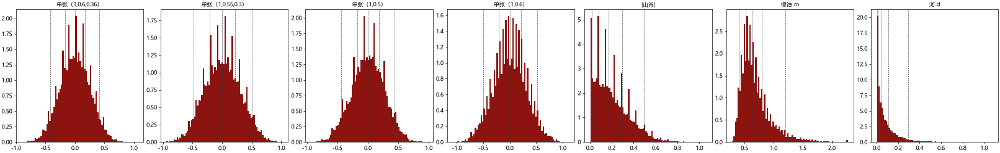

### 噪声 → 波长 → 用途 → 面积占比

波长 = 2^|首倍频| ÷ xz_scale。

| 噪声 | 波长（格） | 用途 | 设计的面积占比 |
|---|---|---|---|
| 盆地 | 570 | 山地与盆地的分界 | 大于 p72 为盆地，p88 以上为堡垒盆心 |
| 谷 | 300（加扭曲） | 隘口与深谷 | 绝对值 p0～p5 谷底、p5～p20 陡坡、p30 以上满山 |
| 主脊 | 233（加扭曲） | 山脊 | 绝对值 p0～p6 峰顶、p30 外为 0.24 以下 |
| 支脉 | 107（对调扭曲） | 支脊 | 绝对值 p0～p8 主线、p45 以外为 0 |
| 区域 | 256 | 山的高低 | p8～p92 线性，高低各半 |
| 尖柱 | 71 | 孤峰 | p90 以上开始，p97 到 0.8 |
| 侵蚀三层 | 100 / 40 / 16 | 沟谷 | 相邻比 2.5，三层乘进 e_k |
| 山麓 | 56 | 低处起伏 | p5 / p50 / p95 对应 -1 / 0 / 1 |
| 3D 粗糙 | 30（竖向压 1.7 倍） | 悬垂与挑檐 | 平地 0.1 倍、山地 1 倍 |
| 域扭曲 | 256，幅 26 格 | 让脊线弯曲，且两套脊线不平行 | |
| 泥沼水凹 | 56 | 血洼 | p26 以下为水，p34 以上为滩 |
| 第一版河 | 128 | 血泽河道（用户指定） | 不变 |
| 材料 A/B/D/E | 8 | 材料分组 | 见第 6 节 |
| 材料 C | 4 | 打碎主体 | 见第 6 节 |
| 材料 M | 32 | 只改三组的混合比例 | 上、中、下三档 |

A～F 的取舍：
- **A 每个尺度一张噪声**：采用。**B 域扭曲**：采用（扭曲 26 格，主脊与支脊对调）。
- **C 先变形再相乘**：采用，山脊 = 样条(绝对值)，区域再乘进去。
- **D 断层台阶**：采用在总高度上（每 15 格一级，占 30%），只在 y 10 格以上的山体；没有单独的断裂平台样条，太像台阶。
- **E 陨坑**：没做。它会在盆地里制造坑，与堡垒盆心冲突。
- **F 密度梯度**：采用。梯度是每格 1/32，3D 粗糙幅固定为 22 格的 1/32。

### 为什么更自然

见 `distribution.png`：灰烬边境的高度直方图从「一个尖峰」变成谷底、高地、脊线三段；坡度直方图的长尾（陡坡）由几乎没有到约 1%；功率谱在波长 30～250 格之间持续下降，不再是上一版那种在短波段抬起的杂乱谱。前一版图含堡垒桥面，短波段偏高部分来自堡垒。

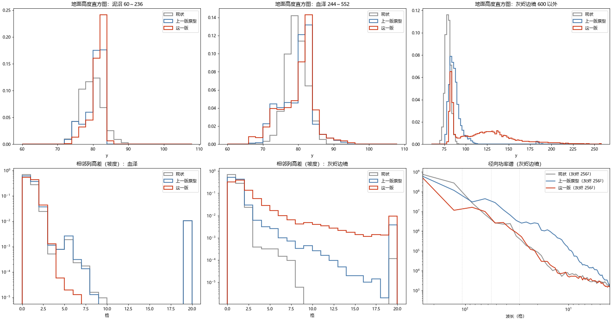

## 5. 三区地形

### 泥沼 36～240
第一版的平泥滩，水凹按 p0～p34 设计；平地以外都有细起伏（波长 24 与 12 格，幅 0.6 与 0.45 格），门半径 44、河庭半径 50 内压平在 82。

### 血泽 240～560
**河流用第一版**（用户指定，宽窄河撤下）。另在水中加岛（短波噪声的 p84 以上，只在水深 3 格以上处长出），让大湖里有泥岛与滩、湖岸破碎。

### 灰烬边境 560 起
- **山墙**：分区摆动半径 556～628 之间由零升到满，隘口由谷噪声切开；离门 560～735 一圈不放盆地，保证血泽外侧是山。
- **山体** = 26 + 36×区域 + 112×脊×(0.4 + 0.6×区域) + 36×支脉×… + 1.3×侵蚀 + 46×孤峰；以谷、盆地、山墙三个权重相乘。
- **盆地**：盆地噪声 p72 以上，底 82 左右（p5 80，p95 98）。占灰烬边境的面积随种子在 11%～44%（含盆心），主种子约 21%。
- **台阶**：15 格一级，占 30%，只在山体上；**岩壁**：陡面用三组另一种组合加少量凝灰岩、黑石。
- **群系**：山地 `pg_mountain`、盆地 `pg_basin`、盆心 `pg_core`。

## 6. 材料与植被

### 规则
- **三组**：① 泥 + 沾泥红树根（主体）；② 砂土 `coarse_dirt` + 红草方块 `grass_block`（草偏少，群系 `grass_color` 红）；③ 绯红菌岩 `crimson_nylium` + 下界疣块 `nether_wart_block`。
- **不成片**：短波噪声 A（8 格）决定组，中波 M（32 格）只改比例；组内再用 B、D 分。主体的两种方块用两张噪声**异或**打碎；用 `vertical_gradient` 做 2% 的逐格随机（1.21.11 的地表规则里，可做逐格随机的只有它，锚点范围 -2032～2031，概率近似常数），只用于边缘咬合。
- **同组相邻**：疣块在菌岩团心（A 更高处）；草方块落在砂土里。
- **水边色带**：按 y 贴着走——水 → 78～79 菌岩/疣 → 80～81 砂土夹草 → 其余；边界用 A、D、E 错开，并由 M 断续。
- **陡面**：三组的另一套组合，斑驳 2～8 格，加黑石、凝灰岩石骨；3D 斑块用 `ore` 地物补，避免陡面出现竖条。
- **灰烬低洼**（y<104、非陡面，山谷、盆地、盆心）：石头 29% / 圆石 24% / 安山岩 23% / 凝灰岩 9%，绯红、砂土、泥点缀约 12%。
- **山尖与山脊**：y 128 起深灰（深板岩、圆石深板岩、凝灰岩），148 石头、168 安山岩、186 闪长岩、204 以上闪长岩与方解石，边界按 ±9 错开，单级 2～3 种石头互掺。实测（山地，主种子）：128～168 为圆石深板岩 40%、深板岩 20%、石头 14%；168～186 为石头 36%、安山岩 35%、闪长岩 14%；186 以上为闪长岩 49%、方解石 23%、安山岩 17%。

### 三区占比（地表，主种子）

| 区 | ① 泥 / 红树根 | ② 砂土 / 草 | ③ 菌岩 / 疣 | 其他 |
|---|---|---|---|---|
| 泥沼 | 35 / 35 | 11 / 3 | 10 / 4 | 血洼 |
| 血泽 | 29 / 27 | 8 / 2 | 22 / 13 | 血河 |
| 灰烬 山地 | 9 / 9 | 8 / 2 | 4 / 2 | 岩石约 66% |
| 灰烬 盆地 | 2 / 2 | 3 / 1 | 5 / 2 | 岩石约 85% |

（数值取自生成后的地表；盆地含盆心。）

### 连通块面积（4 邻接，主种子，不含水与堡垒）

| 区 | 方块 | 中位数 | p95 | 最大 |
|---|---|---|---|---|
| 泥沼 | 泥 | 2 | 45 | 437 |
| | 沾泥红树根 | 2 | 55 | 498 |
| | 砂土 | 3 | 50 | 354 |
| | 草方块 | 3 | 19 | 64 |
| | 菌岩 | 3 | 26 | 614 |
| | 疣块 | 5 | 28 | 111 |
| 血泽 | 泥 / 红树根 | 2 / 2 | 38 / 40 | 393 / 363 |
| | 砂土 / 草 | 3 / 2 | 49 / 16 | 320 / 78 |
| | 菌岩 / 疣 | 2 / 6 | 30 / 49 | 673 / 185 |
| 灰烬山地 | 泥 / 红树根 | 2 / 2 | 25 / 27 | 168 / 176 |
| | 砂土 / 草 | 2 / 3 | 38 / 21 | 220 / 67 |
| | 菌岩 / 疣 | 2 / 2 | 15 / 22 | 86 / 80 |
| 灰烬低洼 | 石头 / 圆石 / 安山岩 | 3 / 3 / 3 | 46 / 48 / 46 | 367 / 419 / 232 |

**离指标的差距**：目标是中位数 3～10、p95 ≤ 60。p95 都达到；中位数多在 2～3，略低，因为多张噪声交界处会切出 1 格的碎屑。再把短波加长会让最大块变大，是取舍。最大值几百格的是水边浅滩（y 78～79 的菌岩）和网状相连的主体；平均块很小。窄带的宽度没有单独量。

### 植被（每区块，主种子）

| 区 | 短草 | 蕨 | 高草 | 大蕨 | 绯红菌索 | 绯红菌 | 合计 |
|---|---|---|---|---|---|---|---|
| 泥沼 | 8.0 | 4.2 | 0.4 | 0.4 | 1.3 | 0.4 | 14.8 |
| 血泽 | 4.2 | 2.2 | 0.1 | 0.1 | 4.4 | 1.5 | 12.5 |
| 山地 | 2.5 | 1.5 | 0.1 | 0.1 | 0.4 | 0.1 | 4.7 |
| 盆地 | 0.9 | 0.6 | 0.1 | 0.1 | 0.7 | 0.2 | 2.5 |

疏密交错用 `noise_threshold_count`（固定种子的群系噪声），每区块株数 p10 / p50 / p90：泥沼 3 / 11 / 30，血泽 1 / 10 / 27，山地 0 / 2 / 14。枯灌木也有但很少。草、蕨、高草长在②上，菌索、菌长在③上，①上少量；每一处都过 `would_survive` 与「脚下是该组方块」两重判断，植被不会在水里，也不会长到建筑上（建筑在地表之后放置，占地的植被会被盖掉）。泥沼的短草 8 株 / 区块，如果觉得少，只改 `design5.json` 的 `veg`。

**更新稳定性**：两片 128×128 的区块，`random_tick_speed` 设 400 跑 1200 tick：草方块、泥、砂土都没有变化；绯红菌岩 2735 中有 4 格变成下界岩（上方有方块），其余不变；植被一株没少。草方块不放在水下（水下改用泥、红树根、疣块）。

## 7. 黑石堡垒、高度与现有逻辑

### 维度
- `dimension_type`：height 256 → **384**，logical_height 384，min_y 0 不变；`noise_settings.noise.height` 384（要与维度类型一致）。地面最高约 315（尖峰 300 左右），离 383 有 60 格以上余量，超过要求的 30 格。
- y 梯度由「16～144 夹住 ±2」改为「0～384 线性」，滑带不需要（地形本身到不了顶）。
- **性能**：同一片灰烬区，256、320、384 都是 86 区块/秒，没有差别。
- **存档必须重置**：维度高度、群系源、噪声都变，旧区块与新区块之间是硬墙。重置步骤：备份后删 `dimensions/rpg/paradise_lost`（人不能在里面），`#built`、`#sites` 归零，`BUILT` 加一，让门和河庭重放。删维度不可逆，动手时由你执行或明确授权。
- **云**：默认云高约 192，会穿过山腰。本原型没改。要云在山上面可把 `visual/cloud_height` 设到约 250，没有测。

### 堡垒（已定：只在盆地）
- 结构 `biomes` 与 `preferred_biomes` 只含盆心 `pg_core`；`START_HEIGHT_OFFSET = -40`、`PILLAR_EXTEND = 136`。
- 盆心要求盆地噪声高于 p84～p88，且离门 715～760 格以上，所以血泽不生成堡垒，堡垒离山墙也够远。
- 实测（主种子两轮、每轮一片 1280×1536；另 5 个种子各一片 1024×1408，其中两个种子片内没有完整堡垒。合计 10 座，1810 件）：被埋的件 0.2%（3 件，都在同一座，早一轮的布点；最终布点的 4 座 659 件为 0）；悬空柱 0；桥面顶 186～196，离盆地地面 104～106；桥面高度约 182～188。
- `concentric_rings`：**distance 5、spread 4、count 90**（现在 7 / 4 / 90）。用 5/3 时 5 个种子离门最近 755～1200；改 5/4 后 3 个种子最近 768～845（主种子 768）。半径 2100 内约 18～30 座，最近邻距离最小 266，不会重叠（堡垒占地约 130～257 格，266 略小于两座并排，有极少重叠风险）。
- **堡主触发**：`in_fortress` 是「结构内且 y ≥ 120」。山里也会高过 120，但它判的是堡垒件的包围盒，堡垒不在山里，所以不会误触；建议把下限改到 **160**（桥面约 182～188，留 20 格余量），没有在游戏里测。
- **露天骸骨**：原来 96～110，现在改 **262～270**（高于大多数山顶，从上往下找第一处地面）。一片 1024×1024 里放出 159 个，地面 96 以上的处 77 个。

### 现有逻辑里和高度有关的

| 项 | 现在 | 新高度下 |
|---|---|---|
| 门的清空 FLOOR+46、河庭清空 +32 | 82 起算，到 128 | 不受影响，门与河庭处地面仍是 82 |
| 小建筑贴地 | `positioned over motion_blocking_no_leaves` | 仍贴地；河庭圈内是平地 |
| 堡垒桥面、柱 | 见上 | 见上 |
| 血月刷怪、基路伯：`spreadplayers … under 200` | 原地面低于 200 | **必须改**：山顶 200 以上时找不到落点会失败，改到约 330；落点可能在堡垒桥面，与现在一样 |
| `in_fortress` 的 y 下限 120 | 谓词 | 建议改 160 |
| `rpg:paradise/fortress` 的落点判定 | 堡主落在玩家前两格 | 不受影响 |
| 海平面 78、血池、红天 | | 不变 |
| `remains` 起点 | 96～110 | 改 262～270 |

## 8. 图与实测

图在读 `.mca` 后自己渲，不是游戏截图；透视图是高度图光线步进，**陡面上的竖条是渲染方式造成的**，真实陡面有三组斑块。

俯视（左现状、中上一版、右这一版）：
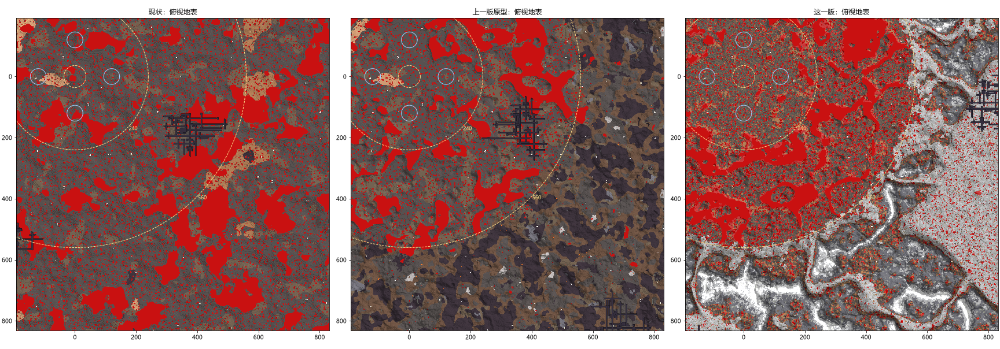

高度（同一色标）：
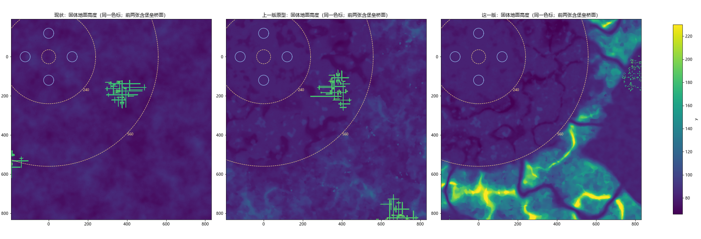

剖面 z=0：
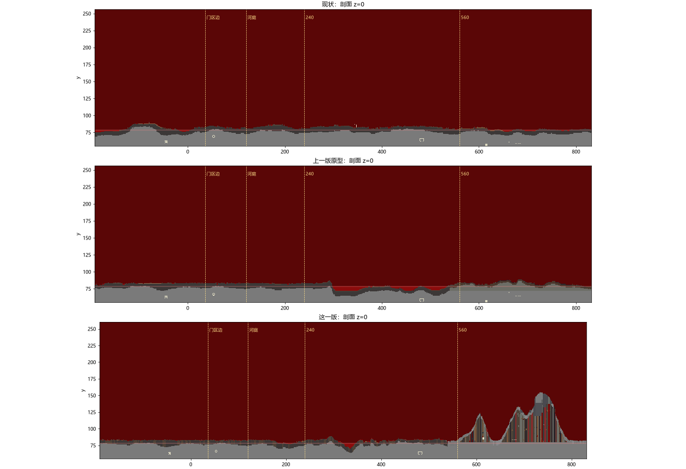

从血泽边缘平视山脉：
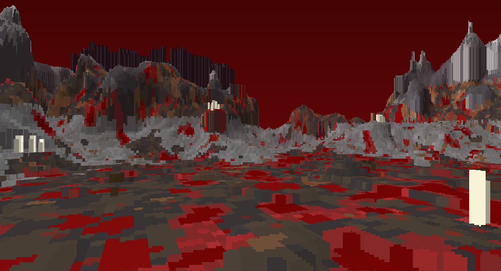

从门高处远眺（天际线）：
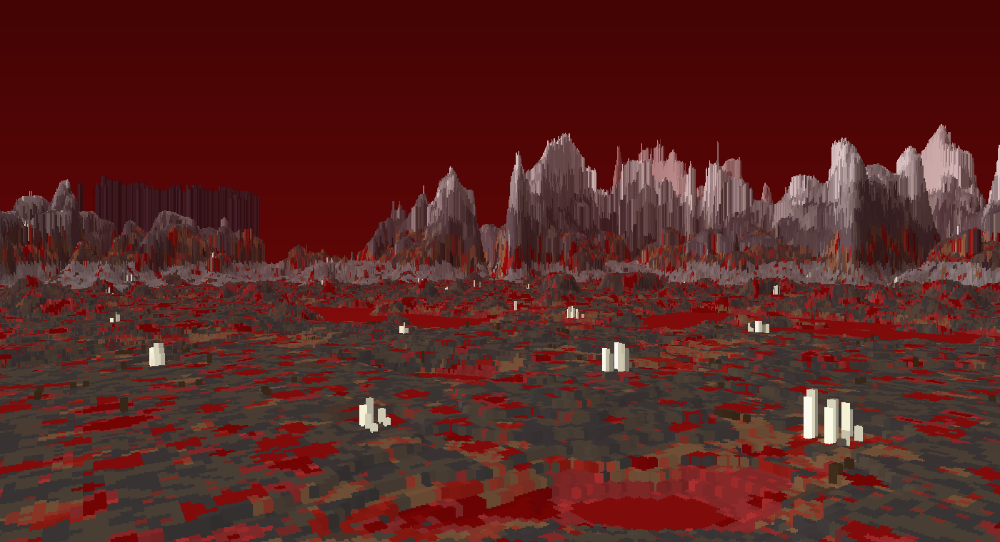

山里近景（深灰到白的山尖）：
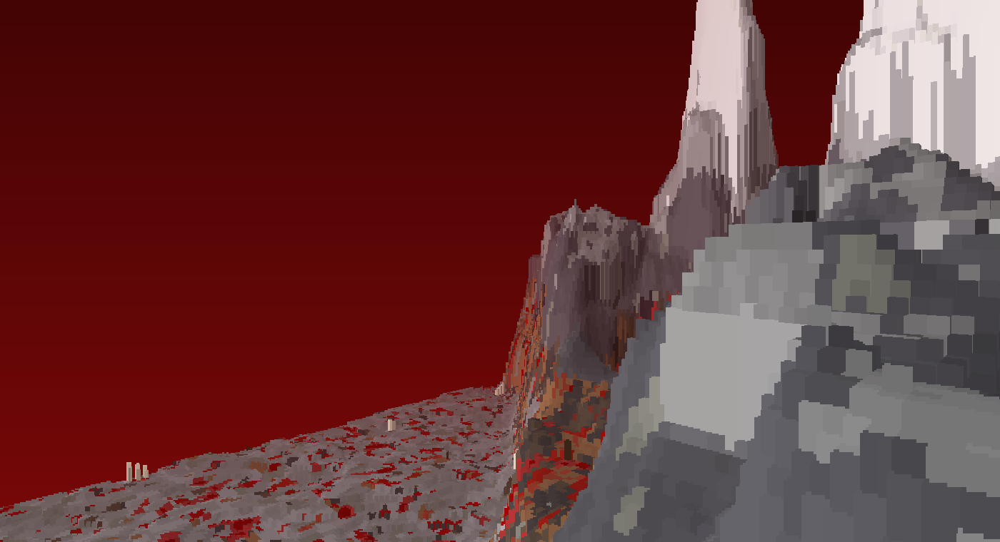

池边近景，这一版与上一版：
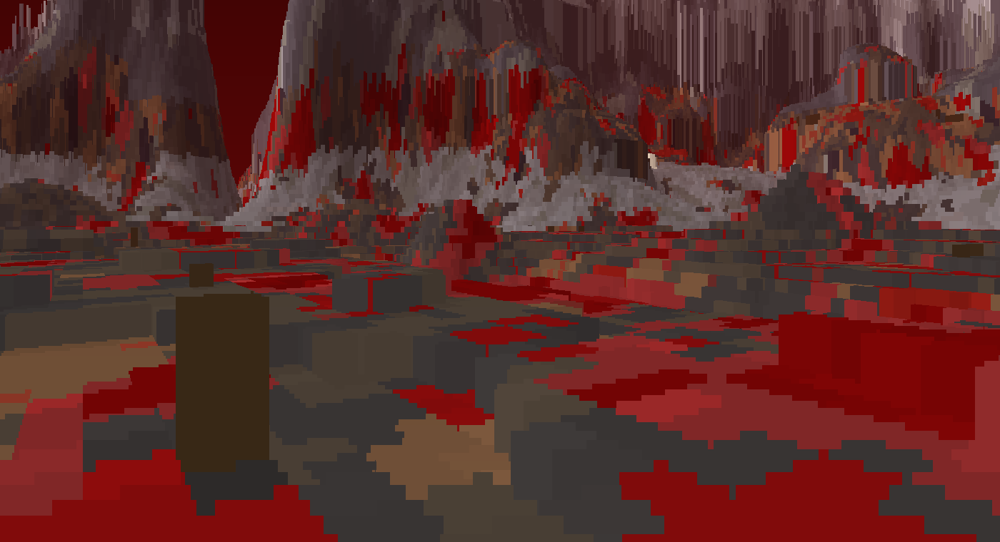
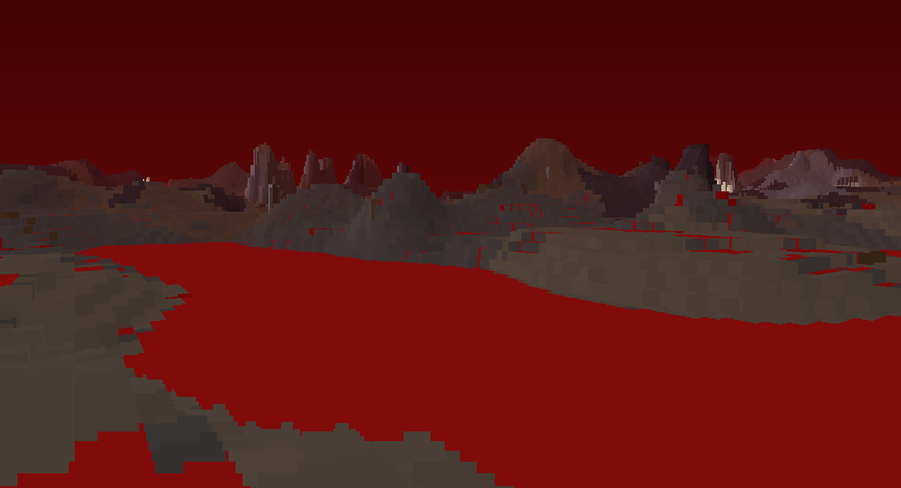

完整数据包执行 `rpg:pl/prepare` 之后（左现状、右这一版）：
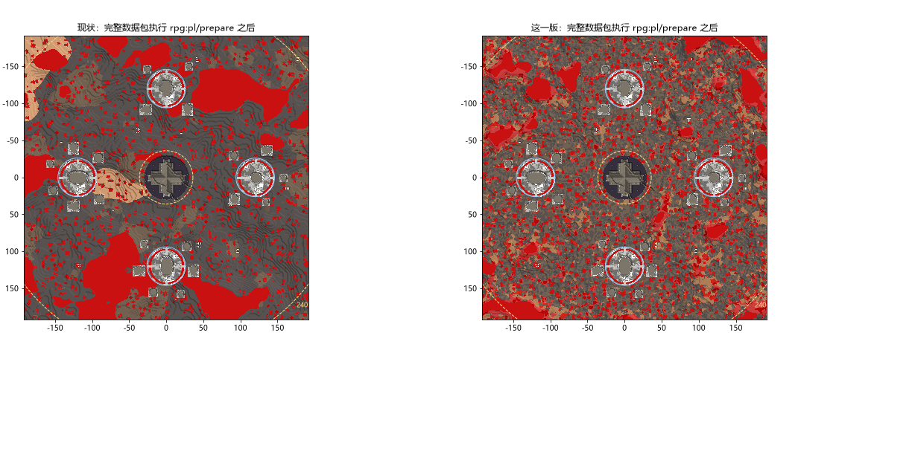

**实测汇总**
- 加载：完整数据包没有解析或生成报错（日志里有一条联网取公钥的超时，与本包无关）。
- 山地高度段（主种子）：<95 占 18%，95～110 占 15%，110～140 占 38%，140～165 占 16%，165～200 占 9%，≥200 占 5%。
- 可达性：从半径 535～548 的血泽外缘出发，上 1 格、下 4 格、水面可走，灰烬边境（640 以外）能到 75%（山地 67%，盆地 98%）；允许搭 2 格、下 8 格时 95%。怪物同理，能寻路但陡脊走不上去。
- 局部落差（±64 格）：p50 132，p95 210，≥100 的占 73%。
- 多种子（1、-77、424242、31337、5550123）：地面最高 293～315，≥110 的占 45%～65%。
- 坐标还原仍是上一版的三张噪声写法，48 个种子的验证见第 3 节。

## 9. 需要你再看的

1. 进游戏看：山墙高度、石柱与孤峰、红色的比例、草的密度。
2. 堡垒桥面：`in_fortress` 的 y 下限改 160、`spreadplayers` 的上限改 330，是否同意。
3. 云高是否提高。
4. 盆地面积：主种子约 21%，个别种子到 44%，想要更少山谷就提高盆地门槛（`basin` 的 60/72）。
5. 上一版河的做法（宽窄河、K 与 t）已撤，`gen4.py`、`gen5.py` 里保留代码但不用。

## 附：来源与许可

- **Epic Terrain**（本体）：MIT，Copyright (c) 2025 wonderfulaichen，仓库 github.com/wonderfulaichen/Epic-Terrain。坡度、逐层侵蚀等思路来自它；代码与数值自己写，没有抄它的文件。若日后采用它成段内容，须附 MIT 的版权与许可声明。
- **CliffTree**：CC BY-NC-SA 4.0。只借了石柱「高度样条 × 噪声样条 × 区域遮罩」的思路，没有抄数值、样条点或文件。
- **用户交付的 Codex 地形包**（`tralancerET`）：只用了另一会话转述的要点（每个尺度一张噪声、域扭曲、先变形再相乘、断层台阶、密度梯度），**没有读它的任何文件，没有抄数值**。它的群系名来自 Terralith，所以群系、地物、结构、标签都没有看。
- **Epic Terrain Compatible**：保留所有权利，没有使用。
- **Terralith**（含同源的 brokenland）：没有采用。`license.txt` 禁止把代码的任何部分放进别的数据包，并禁止用于任何 AI 项目，所以没有读它的密度函数、样条、地表规则、群系、地物；早先读许可与清单时顺带看到过一段洞穴群系参数和一个噪声文件的开头，设计中没有用。
- 参考图 `13.webp` 只当视觉参考，没有查它来自哪个包。
- 机制说明来自原版 1.21.11 的 jar，数值都是自己调的。以上许可信息由用户的另一会话核对后转来。

---

## 10. 主世界：照 World Machine 官方示例学地势（2026-11-26）

参考：`d:\agent\gemini\ShatteredContinent\layout\_official_src\` 里 9 个官方示例经 WM 自带自动化导出的 16 位高度图
（`contact_sheet.png` 是它们的光照拼图）。**只读这些导出图做统计与目视对比，不解析 .tmd，不把高度图放进包里。**
统计脚本与模拟器在会话草稿区（`wm_stats.py`、`sim_alpine.py`），配方库进了仓库：`_tools/terrain_dsl.py`、`_tools/terrain_styles.py`。

### 10.1 参考图的共同特征（降采样到长边 512 后统计）

| 示例 | 高度分布（p5→p95） | 频谱斜率 | 拉普拉斯偏度 | 观感 |
|---|---|---|---|---|
| ridgy_mountains | 0.07 → 0.86，均匀上升 | −4.07 | −0.77 | 树枝状锋利山脊，从平缓冲积平原拔起 |
| coastal_mtn2 | 0.03 → 0.90 | −4.46 | −1.30 | 密集分叉的侵蚀山地 |
| alpine_lakes | 0.11 → 0.92 | −4.39 | −1.03 | 圆缓山体 + 湖盆 |
| monument_valley | 0.01 → 0.89，58% 在同一档 | −4.10 | −1.24 | 大片平坦沉积谷底 + 孤立台地群 |
| grand_canyon | 0.13 → 0.99，有台阶 | −3.62 | +0.64 | 高原被深谷切开，层状台阶 |
| alien_canyons | 0.03 → 0.74 | −3.88 | −0.85 | 平顶被大量沟谷分割 |
| island_chain / pacific_atoll / impact_craters | — | −3.7～−4.1 | — | 岛链、环礁、陨坑 |

共同点：频谱斜率约 −4（大起伏强、碎起伏被侵蚀磨平）；拉普拉斯偏度为负（脊尖谷圆）；低处大片缓坡或平地（沉积）。

### 10.2 做法：双后端配方

密度函数没有侵蚀模拟、没有 Worley，只能用 noise / shifted_noise / add / mul / abs / square / min / max / clamp / spline 拼。
`terrain_dsl.py` 让同一份配方既输出游戏 JSON（`JsonB`），也能用 numpy 离线求值（`NumpyB`，仿 1.21 NormalNoise，
实测标准差 0.27～0.31，和游戏里量的 0.25～0.31 一致，所以 `q(p)` 分位数断点能直接搬）。配方里不许出现坐标还原 x/z，
这样还能在偏移处重算一遍，用差分求坡度。

### 10.3 高山：四轮对比（`docs/terrain/wm_alpine_round*.png`）

| 轮 | 改动 | 结果 |
|---|---|---|
| 0（旧） | `|噪声|` 零等值线描脊 | 蚯蚓状光滑长脊，23% 坡面 >70°，最高 y 780 |
| 1 | 三层脊 + 压平谷底 | 有了平地，但脊是闭合细环（细胞壁） |
| 2 | 山裙 + 门控剪环 | 被压得太平，脊仍蚯蚓状 |
| 3 | **脊状多重分形**：每阶 s=(1−2\|n\|)²，权重=上一阶信号 | 粗糙、分叉、细节只长在脊上，接近 ridgy_mountains |
| 4（采用） | 把钳位换成平滑样条，去折痕 | 主体峰顶约 y 300（海平面上 ~245），极少数孤峰到 ~y 530；坡度档 52/30/15/4% |

拉普拉斯偏度仍比参考尖（−6.7 对 −0.8），主要因为参考图降采样后自带模糊、分辨率不同，这一项不能直接对比；目视与坡度分布已接近。

### 10.4 坡度换材质（用户 2026-11-26）

>70° 方解石、50–70° 石头+原石、20–50° 青色陶瓦。地表规则读不到坡度（`steep` 只看两个方向、固定约 63°），
所以在密度函数里对山体配方做中心差分（±2 格）求 |∇h|²，编码进群系参数 depth，拆出三个子群系
`rpg:alpine_slope` / `alpine_rock` / `alpine_cliff`，各自的地表与岩壁换材质。精度是群系的 4×4 格。

### 10.5 其他同期改动

- 云高 500（dimension_type `attributes.minecraft:visual/cloud_height`）。
- 不放原版泉水；火山口不再用地表规则铺岩浆（会顺外坡流），改成封闭岩浆湖地物，实测岩浆全是静止源。
- 战争前线去掉战壕。
- 树：一律不用原版树，全部来自树木包；构建时拼成树丛模板，按群系换叶（樱花/白桦/黄叶=苍白橡树叶重绘/诡异疣块）。
- 丰饶森林：成片耕地 + 成熟小麦。

### 10.6 还没照参考做的

monument_valley（平顶山沙漠）、grand_canyon / alien_canyons（侵蚀沙漠、云杉木森林峡谷）、alpine_lakes（湖盆）的配方
还是旧写法，下一步按同样流程逐个对比。
